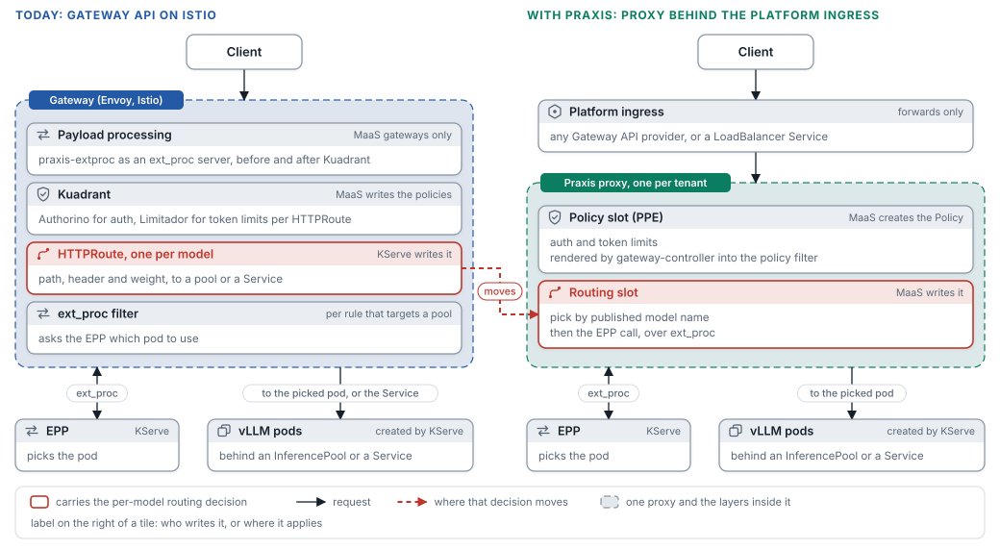

# Context

Praxis data plane, repositories read 2026-11-19.

Moving the data plane from Gateway API on Istio to Praxis changes how a KServe `LLMInferenceService` receives traffic. The move exposes problems in the integration between MaaS and KServe. A status contract on the `LLMInferenceService`, with MaaS as the owner of the routing, can help in the overall migration process.

| Topic | Summary | Detail |
|---|---|---|
| Problem | MaaS and KServe integrate through the HTTPRoute | MaaS looks up the route, attaches its policies to it and derives the tenant from it. Praxis removes the per-model route. |
| What can help | A status contract, and MaaS writes the routing | KServe publishes the backend, the port, the model names and `Ready` in the service status, with or without a route. MaaS writes the routing into the tenant's `Proxy` from it. The details are in [Decision](decision.md). |
| Migration | In stages, per tenant | MaaS and KServe can prepare now. The cut-over moves a tenant at a time and waits on proxy deployment, the EPP client and the policy engine in Praxis. |

## Praxis in the request path

[`gateway-controller`](https://github.com/praxis-proxy/gateway-controller) is not an ingress controller (yet?). It configures a Praxis proxy that is deployed behind the platform's existing ingress. Currently, that ingress ("any GWAPI provider, or none") "just forwards to it". A Gateway can still be the entry point and forward all traffic to Praxis. **The per-model HTTPRoute is removed**. Praxis routes on the `model` field of the request body, and ["no route is ever written"](https://github.com/praxis-proxy/gateway-controller/blob/f6a12554d9294130010ed16abea775657914bb6f/docs/design/api.md?plain=1#L311).

<picture><source media="(prefers-color-scheme: dark)" srcset="figs/request-path-dark.svg"></picture>

Today the per-model routing decision is an HTTPRoute on the Gateway. KServe writes it and Istio answers with status. With Praxis it is proxy configuration keyed on the model name, and the ingress only forwards. The EPP and the pods are the same in both columns.

### Today: who does what, and why

- KServe writes the HTTPRoute, the `InferencePool`, the EPP and the Service. The route exposes the service, and KServe derives `Ready` and the URL from the route status.
- MaaS writes the `AuthPolicy` on the Gateway and a token rate limit policy on each model's HTTPRoute. Kuadrant enforces by attaching to Gateway API objects, so a per-model limit needs a per-model route.
- Istio implements the Gateway. It adds the `ext_proc` filter for rules that target a pool, and it writes the route and pool status.
- On MaaS tenant gateways `praxis-extproc` runs as an `ext_proc` server around Kuadrant. It reads the model name from the request body, among other payload processing.

### With Praxis: who does what, and why

- The platform ingress only forwards. The proxy is not tied to any Gateway API implementation.
- MaaS creates a `Proxy` and a `Policy` per tenant. The `Policy` is a separate object so MaaS can delegate edit access without exposing the `Proxy`.
- `gateway-controller` renders the Praxis config from the `Proxy` and the `Policy`. In the Praxis design a `ModelProvider` per model also feeds the routing, and its API is still open. The rendered config has exactly one owner.
- KServe still creates the EPP, the pool, the Service and the pods. Scheduling stays with the EPP.
- Nothing writes status back to the `LLMInferenceService`. KServe readiness reads route and pool status today, so that has to change.

## Problems in today's integration

Currently, MaaS and KServe integrate through the HTTPRoute and not through a defined contract. MaaS looks up the route, attaches its policies to it and derives the tenant from it. KServe publishes the status MaaS needs only while a route exists. Praxis removes the route, so the items below have to be fixed before a service can be served through Praxis.

### Between MaaS and KServe

| Shortcoming | What it causes | Fix |
|---|---|---|
| MaaS reads KServe's HTTPRoute. There is no single contract on the `LLMInferenceService` status. | MaaS finds the route by label, checks its parent Gateway and takes the hostname from it. 42 places in the MaaS code depend on an HTTPRoute or a Gateway. Without the route a `MaaSModelRef` becomes `Pending` although the service is `Ready`. | MaaS reads the backend, the port, the model names and `Ready` from the service status, and nothing else. |
| KServe only publishes that status when a route exists. | Without a route `status.router` is empty, the address has no port and no model names, and a service with a scheduler never becomes `Ready`. | KServe publishes the same status with or without a route. |
| A MaaS policy is owned by a KServe object. | The per-model rate limit policy targets the HTTPRoute and has it as owner. Deleting the route deletes the limit. | MaaS generates per-model limits that do not attach to a route. This needs Praxis support first ([`policy#352`](https://github.com/praxis-proxy/policy/issues/352), [`policy#308`](https://github.com/praxis-proxy/policy/issues/308), or the `token_rate_limit` filter). |
| Tenant identity is bound to a Gateway. | An `AITenant` fails without a Gateway, and a model's tenant is looked up from its route's parent Gateway. The proposal allows an ingress with no Gateway API. | Keep the Gateway as the tenant's entry point, resolve the tenant from the service's `gateway.refs`, and point an `AITenant` at a `Proxy`. An ingress without Gateway API would need `spec.tenantRef`. |
| The model ID is only published on gateway addresses. | The ID clients send is a contract. MaaS takes it from `status.addresses[].models`, which KServe fills from gateway URLs only. Without a route MaaS rebuilds it from the spec, and AFAICT that misses a name set through a `baseRef` and LoRA adapter names. | KServe publishes served model names without a route. MaaS uses them as the routing key. |
| Which requests go through the EPP is only defined in the HTTPRoute. | KServe's route preset sends seven inference endpoints to the `InferencePool`, which means through the EPP, and every other path, such as `/v1/models`, directly to the workload Service. The service status names the pool, the EPP and the Service, and not which request paths belong to which. The preset is configuration and a service can carry its own route spec, so the list cannot be copied into MaaS. | KServe publishes in status which request paths go through the EPP and which go to the Service directly. MaaS writes the routing from it. |
| Canary weights only exist on a route. | `group` and `weight` are fields of `spec.router.route`, and their status needs a route. `MaaSModelRef` has no weight. A service without a route cannot take part in a canary. | Either KServe allows `group` and `weight` without a route, or MaaS holds the weights. |

### In Praxis

The migration also depends on work in Praxis that is still open. It is outside our control.

| Shortcoming | What it causes | Fix |
|---|---|---|
| The EPP client does not cover the endpoint picker protocol. | It rejects the EPP's list of fallback endpoints, never reports which pod served the request and does not send response bodies to the EPP. AFAICT it has no TLS. It is off in published builds. No issue tracks any of this, and [`ai#165`](https://github.com/praxis-proxy/ai/issues/165) is closed as completed. | File the issues under [`gateway-controller#24`](https://github.com/praxis-proxy/gateway-controller/issues/24), and test against the real EPP with KServe's presets. |
| The policy engine cannot replace Kuadrant for MaaS yet. | No Kubernetes token auth ([`policy#213`](https://github.com/praxis-proxy/policy/issues/213)), no limit per model ([`policy#352`](https://github.com/praxis-proxy/policy/issues/352)), counters per replica ([`policy#127`](https://github.com/praxis-proxy/policy/issues/127)), and the FIPS image is built without the policy filter. The MaaS team's own POC lists these. | Track those four, and decide whether token limits are enforced by the policy engine or by the `token_rate_limit` filter. |
| The control plane is not built. | On `main` at [`f6a1255`](https://github.com/praxis-proxy/gateway-controller/commit/f6a12554d9294130010ed16abea775657914bb6f), `gateway-controller` has four status-only reconcilers and no Gateway API dependency. It has no `ModelProvider` type and does not render or deploy a proxy yet ([`#14`](https://github.com/praxis-proxy/gateway-controller/issues/14) to [`#17`](https://github.com/praxis-proxy/gateway-controller/issues/17), [`#40`](https://github.com/praxis-proxy/gateway-controller/issues/40), [`#42`](https://github.com/praxis-proxy/gateway-controller/issues/42)). | No action on our side. Track it. The [`v1.0.0` milestone](https://github.com/praxis-proxy/gateway-controller/milestone/1) is due 2027-01-20. |

## Gateway API support in Praxis

We checked whether Praxis has a Gateway API implementation that could serve the HTTPRoute KServe already generates. It does not have one we can rely on. The only Gateway API code is in the Rust [`operator`](https://github.com/praxis-proxy/operator), and new work happens in `gateway-controller`: rendering the Praxis config and deploying the proxy are tracked there ([`#14`](https://github.com/praxis-proxy/gateway-controller/issues/14) to [`#17`](https://github.com/praxis-proxy/gateway-controller/issues/17)). The design also rules out a separate Gateway API controller next to it, because the Gateway API implementation "must therefore be the same controller that implements the Praxis Core API" ([`api.md`, section 12](https://github.com/praxis-proxy/gateway-controller/blob/f6a12554d9294130010ed16abea775657914bb6f/docs/design/api.md#12-stance-on-gateway-api)). `gateway-controller` has no Gateway API code, and none of its [49 open issues](https://github.com/praxis-proxy/gateway-controller/issues) is about it.

The operator also cannot serve the HTTPRoute that KServe generates. It passes Gateway API HTTP conformance, core and extended, but thirteen of the sixteen rules in [KServe's route preset](https://github.com/kserve/kserve/blob/cdbe9860583e36f29d46a58179d86299e8faa41d/config/llmisvcconfig/config-llm-router-route.yaml) point at an `InferencePool`, and the operator accepts `core/Service` only ([`src/gateway_api/route_status.rs:142-148`](https://github.com/praxis-proxy/operator/blob/1a9f9d57cd6bf5362291bcf9e1655770747224a3/src/gateway_api/route_status.rs#L142-L148) at [`1a9f9d5`](https://github.com/praxis-proxy/operator/commit/1a9f9d57cd6bf5362291bcf9e1655770747224a3)).

| KServe's route preset uses | Praxis operator (being replaced) | AI Gateway API (design) |
|---|---|---|
| Path and header matches | Yes, prefix and exact | No surface, routes on body `model` |
| Prefix rewrite, 14 of 16 rules | Yes | None |
| Weighted backendRefs | Yes | On `Model.providers[]`, out of v1alpha1 scope |
| Request timeout, 4 rules at 600s | Partial | None |
| `InferencePool` backendRef, 13 of 16 rules | No: `InvalidKind`, generated 500 | Not in the design, only in [PR #26](https://github.com/praxis-proxy/gateway-controller/pull/26) |
| `Service` backendRef, 3 rules | Yes, plaintext upstream only | `backend.serviceRef` |
| Pool parent status for readiness | No | No |
| TLS to pods and to the EPP | Core supports upstream TLS, operator does not emit it | Unspecified |

- The operator has no tags, no releases and no users in the demos. A maintainer wrote on 2026-11-13 that they are "considering archiving" it once `gateway-controller` covers conformance.
- No HTTPRoute support is being built for Praxis today. The AI Gateway API has no Gateway API dependency by design. Gateway API support is only mentioned as something for later ("When we implement GWAPI for praxis", [`policy#104`](https://github.com/praxis-proxy/policy/issues/104#issuecomment-6942155676), 2026-11-17), with no issue and no date.
- The HTTPRoute does not need translating. Most of it is specific to Gateway API. Six pieces of information have to be passed on, and only KServe has them: the backend (pool or Service, name, port), which request paths go through the EPP and which go to the Service directly, served model names including LoRA adapters, backend TLS and its trust anchor, lifecycle (ready, stopped, deleting), and `group` and `weight` if the service stays the canary API.
- Not available unless Praxis implements them: the catch-all rules that send non-inference paths such as `/v1/models` to the Service, and the unlimited request timeout.

## Not verified

The findings are based on reading code, issues and the proposal. The following was not verified.

- Nothing was run on a cluster. What the operator does with KServe's route is read from code.
- Whether [PR #26](https://github.com/praxis-proxy/gateway-controller/pull/26) on `gateway-controller` is still the intent. It was last pushed on 2026-11-12 and is unapproved. The pivot to the current proposal is not in any public thread.
- How the proxy is deployed. `gateway-controller` has open issues for the `Proxy` ConfigMap, Deployment and Service ([`#15`](https://github.com/praxis-proxy/gateway-controller/issues/15) to [`#17`](https://github.com/praxis-proxy/gateway-controller/issues/17)) and nothing merged.
- That the Praxis `ext_proc` client cannot do TLS. This is inferred from its config and dependencies.
