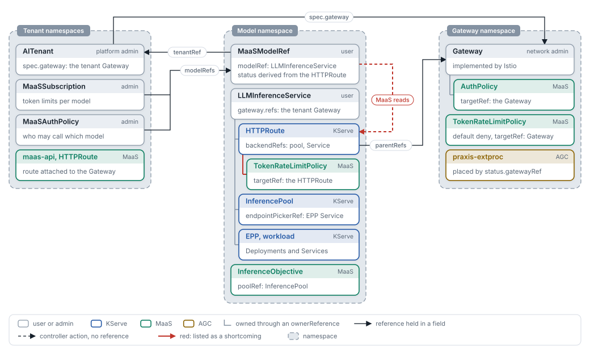
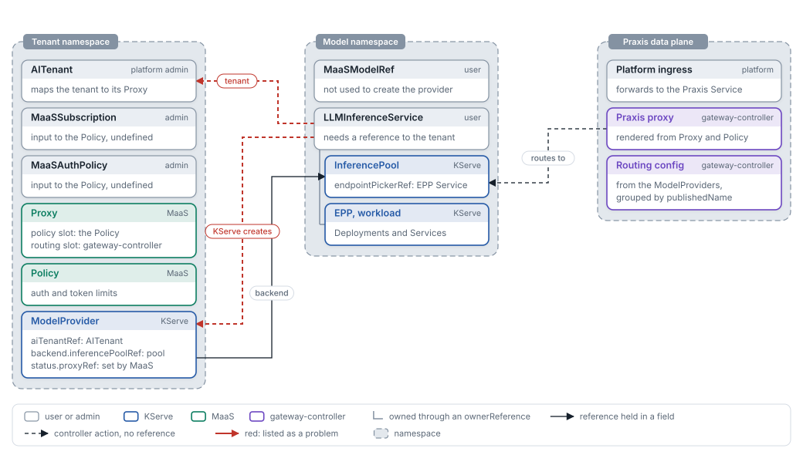
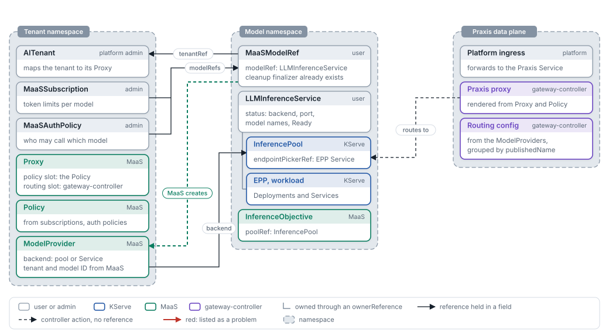
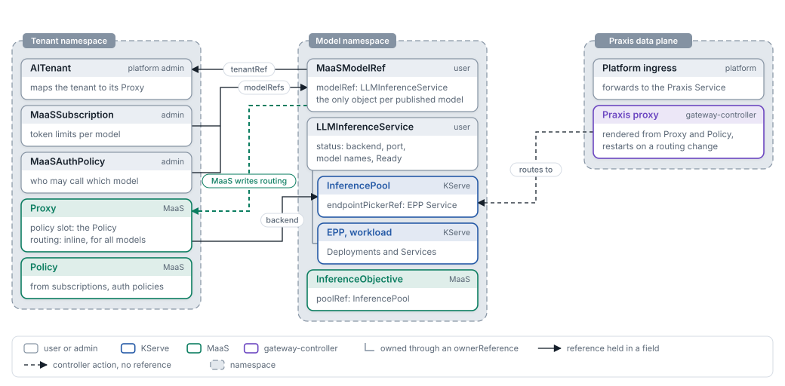

# Custom resources, references and owners

Praxis data plane, MaaS and KServe.

Serving a KServe model through MaaS involves custom resources written by several controllers. The figures show which object references which, which object owns which, and which controller writes each object, in four setups: the current one on Gateway API, option 1 where KServe creates the `ModelProvider`, option 2 where MaaS creates it, and option 3 where MaaS writes the routing and the `ModelProvider` comes later.

## Reading the figures

All four figures use the same three columns, one per namespace, and the same marks.

- The colour of a tile and the label in its header name who writes the object: a user or an admin, KServe, MaaS, `gateway-controller`, or the AI Gateway controller (AGC).
- A tile indented under another is owned by it through an `ownerReference`.
- A solid arrow is a reference held in a field. It points from the object that holds the field.
- A dashed arrow is an action of a controller with no reference between the two objects.
- Red marks a relationship that is listed under the figure as a problem.

## Today: Gateway API with Kuadrant

The HTTPRoute is the central object today. KServe creates it, the tenant Gateway admits it, and MaaS both reads it and attaches a policy to it. As a result, objects written by MaaS depend on an object that KServe owns.

<picture><source media="(prefers-color-scheme: dark)" srcset="figs/relationships-today-dark.svg"></picture>

The per-model `TokenRateLimitPolicy` is written by MaaS and owned by the HTTPRoute that KServe creates. `MaaSModelRef` takes its status from the same route.

### Who does what, and why

- KServe creates the HTTPRoute, the `InferencePool`, the EPP and the workload, and owns all of them through the `LLMInferenceService`. It derives `Ready` and the URL from the status Istio writes on the route and the pool.
- MaaS reads the HTTPRoute and the service status to set the status of a `MaaSModelRef`. From a `MaaSAuthPolicy` it creates one `AuthPolicy` on the Gateway. From a `MaaSSubscription` it creates one `TokenRateLimitPolicy` per model, with the HTTPRoute as target and owner, and an `InferenceObjective` per pool.
- AGC deploys `praxis-extproc` and its `EnvoyFilter` for the Gateway named in `AITenant.status.gatewayRef`.
- Istio implements the Gateway and writes route and pool status. Kuadrant enforces the `AuthPolicy` and the rate limit policies.

### Relationships that cause problems

- A MaaS policy is owned by a KServe object. Deleting the HTTPRoute deletes the per-model rate limit.
- MaaS depends on the HTTPRoute, which is an implementation detail of KServe, and not on the `LLMInferenceService` status.
- The tenant is bound to a Gateway. An `AITenant` fails without one, and when `tenantRef` is empty the tenant of a model is looked up from the route's parent Gateway.

## Option 1: KServe creates the ModelProvider

Option 1 replaces the per-model HTTPRoute with a `ModelProvider` that KServe creates in the tenant namespace. MaaS completes the object by setting `status.proxyRef`, and `gateway-controller` renders the routing from it.

<picture><source media="(prefers-color-scheme: dark)" srcset="figs/relationships-option-1-dark.svg"></picture>

The `ModelProvider` is the only object in the tenant namespace that MaaS does not create. It has three writers: KServe for the spec, MaaS for `status.proxyRef`, and `gateway-controller` for readiness.

### Who does what, and why

- KServe creates the pool, the EPP and the workload as today, and one `ModelProvider` per service in the tenant namespace. It sets the tenant, the pool and the weight, and changes the weight during a canary.
- MaaS creates the `Proxy` and the `Policy`, maps the `AITenant` to the `Proxy`, and sets `status.proxyRef` on each provider so that `gateway-controller` does not have to read the `AITenant`.
- `gateway-controller` reads the `Proxy`, the `Policy` and the providers. It deploys the Praxis proxy, writes the routing config grouped by `publishedName`, and writes readiness on the provider.
- The platform ingress forwards all traffic to the Praxis Service.

### Relationships that cause problems

- KServe writes into a namespace it does not manage. An `ownerReference` cannot cross namespaces, so nothing ties the lifetime of the provider to the service.
- KServe has no tenant. An `LLMInferenceService` has no tenant field, and resolving the tenant "through gatewayRef" requires a Gateway.
- One object has three writers, and two of them write its status.
- `MaaSModelRef`, `MaaSSubscription` and `MaaSAuthPolicy` have no defined role. One service can be published to several tenants today, which a single `aiTenantRef` cannot express.
- `inferencePoolRef` holds only a name, while the pool is in another namespace.

## Option 2: MaaS creates the ModelProvider

In option 2 KServe publishes the backend in the `LLMInferenceService` status, and MaaS creates a `ModelProvider` for each `MaaSModelRef`. Every object in the tenant namespace then has one writer, and KServe writes only in the model namespace.

<picture><source media="(prefers-color-scheme: dark)" srcset="figs/relationships-option-2-dark.svg"></picture>

MaaS writes every object in the tenant namespace, and KServe writes only next to the service. The one relationship that still crosses namespaces is the reference from the provider to its backend.

### Who does what, and why

- KServe creates the pool, the EPP and the workload, and publishes the backend, the port, the served model names and `Ready` in status. It creates nothing in the tenant namespace and needs no tenant.
- MaaS reads that status. For each `MaaSModelRef` it creates a `ModelProvider`, with the tenant taken from `spec.tenantRef`, and removes it through the cleanup finalizer it already has on `MaaSModelRef`. It creates the `Proxy` and the `Policy` from the tenant, the subscriptions and the auth policies.
- `gateway-controller` does the same as in option 1, and no longer shares the status of the provider with MaaS.

### Open points

- The provider references a backend in another namespace. The Praxis design leaves that access to NetworkPolicy and admission policy.
- No `ownerReference` links a `MaaSModelRef` to its provider either, because they are in different namespaces. The finalizer covers deletion.
- When a service is stopped or deleted, KServe removes the pool and the Service immediately, but the provider stays in the Praxis configuration until MaaS removes it.
- Canary weights need an owner: they are either copied from the service or defined in MaaS.

## Option 3: MaaSModelRef only, ModelProvider later

Option 3 is option 2 without the `ModelProvider`. MaaS writes the routing of each `MaaSModelRef` directly into the `Proxy` of the tenant, and `gateway-controller` renders it. The `ModelProvider` API can be adopted later without a change for users or for KServe.

<picture><source media="(prefers-color-scheme: dark)" srcset="figs/relationships-option-3-dark.svg"></picture>

No object represents the routing of a single model. It is part of the `Proxy`, which MaaS already writes.

### Who does what, and why

- The user writes the same `MaaSModelRef` as today. Its spec needs no new field, because the backend, the port and the model names come from the service status. Its `httpRoute*` status fields have no source without a route, as in option 2.
- KServe does the same as in option 2. It publishes the backend, the port, the served model names and `Ready` in status.
- MaaS reads that status and writes the routing of every published model of a tenant into the tenant's `Proxy`, next to the policy slot. The proposal allows this: when the routing slot is not delegated, "routing stays MaaS-defined".
- `gateway-controller` renders the `Proxy` and the `Policy`. It does not need the `ModelProvider` type, which is not implemented yet ([`#40`](https://github.com/praxis-proxy/gateway-controller/issues/40), [`#42`](https://github.com/praxis-proxy/gateway-controller/issues/42)).

### Limits

- In the current draft a routing change rolls the proxy pods. A `Proxy` has no field for a mounted routing file, so the routing is part of the rendered configuration. The draft that renders the proxy ([`gateway-controller#82`](https://github.com/praxis-proxy/gateway-controller/pull/82)) sets a revision of that configuration as an annotation on the pod template, so the Deployment rolls on every change.
- Today it covers services without a scheduler, and no canary. The Praxis EPP client takes one static target and has no TLS. Options 1 and 2 have the same limit until that client is extended.
- All models of a tenant are in one object, so every publish and unpublish is a write to the same `Proxy`.
- The routing renderer in MaaS is discarded when the `ModelProvider` arrives. MaaS then creates one provider per `MaaSModelRef`, which is option 2.

## Comparison

The table lists the relationships that change between the four setups.

| Relationship | Today | Option 1 | Option 2 | Option 3 |
|---|---|---|---|---|
| Routing entry for a model | HTTPRoute, created by KServe | `ModelProvider`, created by KServe | `ModelProvider`, created by MaaS | Routing inline in the tenant's `Proxy`, written by MaaS |
| Its owner | `LLMInferenceService`, through an `ownerReference` | None. The service is in another namespace | MaaS, through the finalizer on `MaaSModelRef` | The `Proxy`, which MaaS owns |
| Its writers | KServe for the spec, Istio for the status | KServe for the spec, MaaS and `gateway-controller` for the status | MaaS for the spec, `gateway-controller` for the status | MaaS for the spec, `gateway-controller` for the status |
| Source of the tenant | `MaaSModelRef.spec.tenantRef`, or the route's parent Gateway | A lookup "through gatewayRef" from the service, not defined | `MaaSModelRef.spec.tenantRef` | `MaaSModelRef.spec.tenantRef` |
| What MaaS reads from KServe | The HTTPRoute and the service status | Not specified | The service status only | The service status only |
| What KServe has to know | The tenant Gateway | The tenant, and the Praxis `ModelProvider` type | Nothing new | Nothing new |
| Per-model token limit | `TokenRateLimitPolicy` owned by the HTTPRoute | Rules in the `Policy` | Rules in the `Policy` | Rules in the `Policy` |
| Writes outside the writer's own namespaces | MaaS writes policies into the model and the gateway namespaces | KServe writes the provider into the tenant namespace | MaaS writes the `InferenceObjective` into the model namespace | MaaS writes the `InferenceObjective` into the model namespace |

## Not verified

The current setup is read from the MaaS, KServe and AGC code. The three options describe objects that do not exist yet.

- Option 1 follows the proposal draft dated 2026-11-19. `Proxy` and `Policy` exist as types in `gateway-controller`, and `ModelProvider` does not.
- The namespaces of the Praxis objects follow the example in the proposal, which places them in the tenant namespace.
- In option 2, removing the provider through the existing finalizer on `MaaSModelRef` is new code. The finalizer and its cleanup hook exist.
- Whether an `InferenceObjective` has an owner was not checked.
- Option 3 relies on the proposal's remark that routing stays MaaS-defined when the routing slot is not delegated. What an inline filter chain in a `Proxy` can express was read from the types, and nothing renders it yet.
- The pod roll on a routing change in option 3 is read from the draft [`gateway-controller#82`](https://github.com/praxis-proxy/gateway-controller/pull/82) at [`aa8180f`](https://github.com/praxis-proxy/gateway-controller/commit/aa8180fdf5734289cfdfcfd6efcd6a744e41b485). It was not run, and the draft can change before it merges.
- None of this was run on a cluster.
