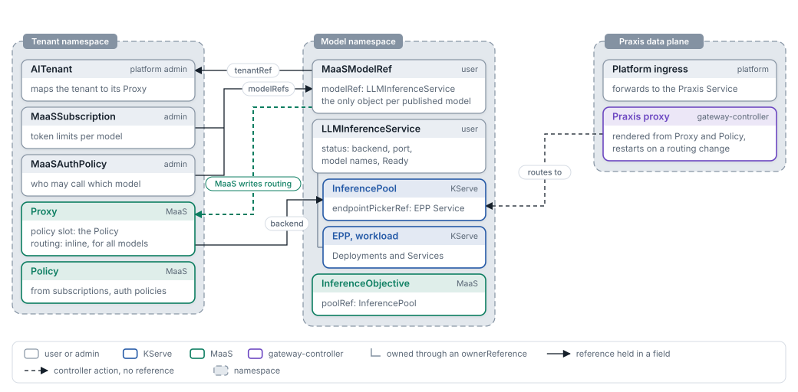

# Routing MaaS-published KServe models through Praxis

Decision record, MaaSModelRef only, ModelProvider later.

The data plane moves from Gateway API on Istio to Praxis. The decision covers how a KServe `LLMInferenceService` that is published through MaaS is served in that setup: what KServe publishes about the service, which component writes its routing in Praxis, and what users write. KServe publishes the backend in the `LLMInferenceService` status, MaaS writes the routing into the `Proxy` of the tenant, and `MaaSModelRef` stays the object users write. The `ModelProvider` API can be adopted later.

| Topic | Summary | Detail |
|---|---|---|
| Status | Approved | The preferred option was discussed as option 3. Options 1 and 2 are described in [Alternatives](alternatives.md). |
| Decision | MaaS writes the routing into the tenant's Proxy | KServe publishes the backend, the port, the model names and `Ready` in the service status, and MaaS reads it for each `MaaSModelRef`. No `ModelProvider` is created. |
| Next step | ModelProvider when its API is defined | MaaS then creates one provider per `MaaSModelRef`. Users and KServe change nothing. |

## Context

Praxis routes on the model name in the request body, and no per-model HTTPRoute is written. Today MaaS looks up that route, attaches its policies to it and derives the tenant from it, and KServe publishes the status MaaS needs while the route exists. In the Praxis design the object that replaces the route is the `ModelProvider`, and its API is still open ([`#40`](https://github.com/praxis-proxy/gateway-controller/issues/40), [`#42`](https://github.com/praxis-proxy/gateway-controller/issues/42)). The request path, the shortcomings the move exposes and the state of Praxis are described in [Context](context.md).

## Goals and non-goals

We keep the scope small on purpose, given the timelines. The non-goals list what is left out of this step.

### Goals

- A model published through MaaS is served through Praxis.
- Users and the dashboard keep writing the same objects. Clients keep the hostname, the request URL with the model in the body, and the model ID.
- MaaS and KServe integrate through one contract, the `LLMInferenceService` status, which does not depend on how the data plane routes. Every object has one writer.
- Upstream KServe needs no Praxis types and no tenant concept.
- The first step does not wait for APIs that are still open in Praxis, and the `ModelProvider` can be adopted later without a user-facing change.
- A tenant can move in stages and be rolled back, and the preparation can start before Praxis is ready.

### Non-goals

- The move to Praxis itself. It is the starting point and is not decided here.
- Services that are not published through MaaS. How they are served is open and is not decided here.
- Gateway API support in Praxis, or a translation of the HTTPRoute that KServe generates.
- Replacing `MaaSModelRef` as the object users write, or defining the `ModelProvider` API.
- Weighted routing between services in the first step. The weights stay on the service and KServe publishes them in status, so they are available when Praxis routes by weight.
- An ingress without Gateway API. The tenant Gateway stays in front of the proxy.
- Per-model path URLs of the form `/<namespace>/<name>/v1/...` through Praxis.
- Moving a single model. The unit of the cut-over is the tenant.

## Decision

We propose to keep `MaaSModelRef` as the only object a user writes to publish a model. KServe publishes what it already knows about the service in its status: the backend, the port, the served model names and `Ready`, with or without a route. MaaS reads that status and writes the routing of each published model into the `Proxy` of the tenant, next to the policy slot, and `gateway-controller` renders it. No `ModelProvider` is created.

The status also has to say which request paths go through the EPP and which go to the workload Service directly. That split is only defined in the HTTPRoute today, and the routing MaaS writes needs both kinds of entries.

<picture><source media="(prefers-color-scheme: dark)" srcset="figs/relationships-option-3-dark.svg"></picture>

No object represents the routing of a single model. It is part of the `Proxy`, which MaaS already writes. The marks are explained in [Alternatives](alternatives.md).

### Who does what, and why

- The user writes the same `MaaSModelRef` as today. Its spec needs no new field, because the backend, the port and the model names come from the service status. Its `httpRoute*` status fields have no source without a route.
- KServe creates the pool, the EPP and the workload, and publishes the backend, the port, the served model names and `Ready` in status. It creates nothing in the tenant namespace and needs no tenant.
- MaaS reads that status and writes the routing of every published model of a tenant into the tenant's `Proxy`, next to the policy slot. The proposal allows this: when the routing slot is not delegated, "routing stays MaaS-defined". MaaS creates the `Policy` from the subscriptions and the auth policies.
- `gateway-controller` renders the `Proxy` and the `Policy`. It does not need the `ModelProvider` type, which is not implemented yet ([`#40`](https://github.com/praxis-proxy/gateway-controller/issues/40), [`#42`](https://github.com/praxis-proxy/gateway-controller/issues/42)).

### The service spec and the Gateway

- `spec.router.route` stays in the service spec, with `group` and `weight` when a canary needs them. KServe publishes them in status, and it does not create the HTTPRoute for a service that is served through Praxis.
- `spec.router.gateway.refs` stays in use. MaaS resolves the tenant from it, and KServe finds the Gateway of the service through it.
- KServe recognises a Praxis-based deployment from the Gateway the service references. How the Gateway shows that is an open question.

## Benefits

- **One contract between MaaS and KServe**: the `LLMInferenceService` status. MaaS no longer depends on the HTTPRoute, its labels, its parent Gateway or its hostnames.
- **One writer per object.** MaaS writes every object in the tenant namespace, and KServe writes only next to the service.
- **Dependencies in one direction.** KServe needs no tenant information, creates no Praxis object and does not depend on a Praxis CRD being installed, so upstream KServe stays vendor-neutral.
- **No dependency on the `ModelProvider` API.** It is open with no milestone, and this option needs the `Proxy` and the `Policy` only.
- **Nothing changes in what users and the dashboard write.** `MaaSModelRef` needs no new spec field.
- **Several tenants per service need no extra API.** One service can be published to several tenants today, with one `MaaSModelRef` each.
- **Adopting the `ModelProvider` later needs no change for users or for KServe.** The contract with KServe and the user-facing objects stay the same.

## Costs and limits

- In the current draft a routing change rolls the proxy pods. A `Proxy` has no field for a mounted routing file, so the routing is part of the rendered configuration. The draft that renders the proxy ([`gateway-controller#82`](https://github.com/praxis-proxy/gateway-controller/pull/82)) sets a revision of that configuration as an annotation on the pod template, so the Deployment rolls on every change.
- Today the routing covers services without a scheduler, and no canary. The Praxis EPP client takes one static target, and how its connection to the EPP is secured is an open question. The alternatives have the same limit until that client is extended.
- All models of a tenant are in one object, so every publish and unpublish is a write to the same `Proxy`.
- The routing renderer in MaaS is discarded when the `ModelProvider` arrives. MaaS then creates one provider per `MaaSModelRef`.
- A service without a `MaaSModelRef` has no routing entry. How services that are not published through MaaS are served is open.
- When an `LLMInferenceService` is stopped or deleted, KServe removes the pool and the Service immediately, but the routing entry stays in the Praxis configuration until MaaS removes it. Until then Praxis routes requests to a backend that no longer exists, so MaaS has to remove the entry as soon as the service stops.
- Canary weights stay on the service, in `spec.router.route`, and MaaS reads them from the service status. We would not add a weight field to `MaaSModelRef`, because it would compete with the weight of a `ModelProvider` later.

## Open questions

- **How KServe recognises a Gateway that is in front of a Praxis proxy.** KServe already fetches the Gateway and its `GatewayClass` for every parent of a route ([`router_discovery.go:61-86`](https://github.com/kserve/kserve/blob/cdbe9860583e36f29d46a58179d86299e8faa41d/pkg/controller/v1alpha2/llmisvc/router_discovery.go#L61-L86)), so the lookup is available. Which property carries the signal is not decided. The `GatewayClass` identifies Praxis only if that Gateway has a class of its own: a Praxis class exists in the Rust `operator`, named `praxis` with the controller `praxis.sh/gateway-controller` ([`deploy/gatewayclass.yaml:1-6`](https://github.com/praxis-proxy/operator/blob/1a9f9d57cd6bf5362291bcf9e1655770747224a3/deploy/gatewayclass.yaml#L1-L6)), and a Gateway from another provider carries the class of that provider. An annotation on the Gateway is the other candidate, as KServe reads `serving.kserve.io/model-based-routing-only` from it today ([`router.go:83`](https://github.com/kserve/kserve/blob/cdbe9860583e36f29d46a58179d86299e8faa41d/pkg/controller/v1alpha2/llmisvc/router.go#L83)). The integration proposal in `gateway-controller` names neither and leaves the question open ([PR #26](https://github.com/praxis-proxy/gateway-controller/pull/26)).
- **Transport security between the proxy and the EPP.** KServe enables TLS on the EPP through a cluster-wide setting. At the time of writing, the EPP client in Praxis exposes no TLS configuration, and its gRPC dependency is built without TLS support. This is based on code inspection and has not been validated on a cluster. The options are to add TLS support to the client or to run the EPP without TLS for traffic from Praxis, and the choice has not been made.

## Dependencies

Delivering the decision depends on work in Praxis that is not ours. The cut-over of a tenant waits for it. The dates and the stages are in [Migration](migration.md).

- `gateway-controller` renders and deploys the proxy from a `Proxy` and a `Policy`. This is tracked in [`gateway-controller#14`](https://github.com/praxis-proxy/gateway-controller/issues/14) to [`#17`](https://github.com/praxis-proxy/gateway-controller/issues/17) and in the draft [`gateway-controller#82`](https://github.com/praxis-proxy/gateway-controller/pull/82).
- The EPP client of Praxis selects its target per model and sends response bodies to the EPP. Services with a scheduler need it. No issue is open for it, and [`ai#165`](https://github.com/praxis-proxy/ai/issues/165) is closed as completed.
- The policy engine supports Kubernetes token authentication and authorization ([`policy#213`](https://github.com/praxis-proxy/policy/issues/213), [`policy#214`](https://github.com/praxis-proxy/policy/issues/214)), a token limit per model ([`policy#352`](https://github.com/praxis-proxy/policy/issues/352), [`policy#308`](https://github.com/praxis-proxy/policy/issues/308)) and limit counters shared between replicas ([`policy#127`](https://github.com/praxis-proxy/policy/issues/127)).

## Security and privacy

- Authentication and authorization move from Kuadrant policies on the Gateway to a Praxis `Policy`, which MaaS generates from the same `MaaSAuthPolicy` and `MaaSSubscription` objects. The policy engine has no Kubernetes token authentication yet ([`policy#213`](https://github.com/praxis-proxy/policy/issues/213)), so a tenant cannot be cut over before it has.
- KServe gets no new permissions. It writes only in the model namespace and needs no access to the tenant namespace or to Praxis types.
- MaaS needs permissions for the Praxis types in the tenant namespace, and it keeps writing the `InferenceObjective` into the model namespace.
- The proxy of a tenant sends requests to pods in the model namespaces. The Praxis design leaves that access to NetworkPolicy and admission policy, and on the ODH build strict NetworkPolicy has to allow the namespace of the proxy.
- The TLS of the EPP is controlled by a cluster-wide KServe setting. How the connection from the proxy to the EPP is secured is an open question.
- No new data is stored. The proxy reads the request body to find the model name, as `praxis-extproc` does on MaaS gateways today.

## Adopting the ModelProvider later

The preferred option is the first step towards option 2 in [Alternatives](alternatives.md), where MaaS creates one `ModelProvider` per `MaaSModelRef`. The step can be taken when the API is defined and implemented.

- `gateway-controller` adds the type, its controller and the routing that is generated from it.
- MaaS stops writing routing entries into the `Proxy`, creates one `ModelProvider` per `MaaSModelRef`, and hands the routing slot of the tenant to `gateway-controller`.
- KServe changes nothing, because the status contract is the same.
- Users change nothing, because `MaaSModelRef` stays the object they write. The Praxis design maps it the same way: a `MaaSModelRef` becomes a `Model` and a `ModelProvider` ([`docs/design/api.md:549`](https://github.com/praxis-proxy/gateway-controller/blob/f6a12554d9294130010ed16abea775657914bb6f/docs/design/api.md?plain=1#L549)).
- Which `ModelProvider` arrives is open. The design in the repository and the proposal describe different fields, and the design leaves weighting and failover out of scope ([`docs/design/api-v1alpha1.md:386-387`](https://github.com/praxis-proxy/gateway-controller/blob/f6a12554d9294130010ed16abea775657914bb6f/docs/design/api-v1alpha1.md?plain=1#L386-L387)).

## Changes in upstream KServe

KServe creates no new objects. It has to publish complete status for a service without a route: today such a service with a scheduler never becomes `Ready`, and its status does not include the pool. We read this from [`kserve/kserve`](https://github.com/kserve/kserve) master at [`cdbe986058`](https://github.com/kserve/kserve/commit/cdbe9860583e36f29d46a58179d86299e8faa41d), in the files under `pkg/controller/v1alpha2/llmisvc/`. The sizes are estimates from reading the code. None of it has been implemented.

| Change | Today | Size |
|---|---|---|
| Mark a service with a scheduler and no route `Ready`, and publish its pool in `status.router.scheduler` with the v1 API group. One PR. | It stays `InferencePoolReady=False` with reason `WaitingForGateway` ([`router.go:801`](https://github.com/kserve/kserve/blob/cdbe9860583e36f29d46a58179d86299e8faa41d/pkg/controller/v1alpha2/llmisvc/router.go#L801), [`:975`](https://github.com/kserve/kserve/blob/cdbe9860583e36f29d46a58179d86299e8faa41d/pkg/controller/v1alpha2/llmisvc/router.go#L975)), and `status.router` is cleared ([`router.go:484`](https://github.com/kserve/kserve/blob/cdbe9860583e36f29d46a58179d86299e8faa41d/pkg/controller/v1alpha2/llmisvc/router.go#L484)). Both changes have to ship together because MaaS interprets "`Ready` and no pool in status" as a service without a scheduler. | Small, status only |
| Publish which request paths go through the EPP and which go to the workload Service directly. | The split exists only in the route preset. Thirteen of its sixteen rules send seven inference endpoints, such as `/v1/chat/completions`, to the `InferencePool`, and [three catch-all rules](https://github.com/kserve/kserve/blob/cdbe9860583e36f29d46a58179d86299e8faa41d/config/llmisvcconfig/config-llm-router-route.yaml#L439-L495) send every other path, such as `/v1/models`, to the workload Service. The status names the pool, the EPP ([`llm_inference_service_types.go:791-799`](https://github.com/kserve/kserve/blob/cdbe9860583e36f29d46a58179d86299e8faa41d/pkg/apis/serving/v1alpha2/llm_inference_service_types.go#L791-L799)) and the Service ([`:887`](https://github.com/kserve/kserve/blob/cdbe9860583e36f29d46a58179d86299e8faa41d/pkg/apis/serving/v1alpha2/llm_inference_service_types.go#L887)), and no paths. | Medium, API change |
| Publish served model names on the address of a service with no route. | `status.addresses[].models` is filled from gateway URLs only ([`router_discovery_filter.go:90-157`](https://github.com/kserve/kserve/blob/cdbe9860583e36f29d46a58179d86299e8faa41d/pkg/controller/v1alpha2/llmisvc/router_discovery_filter.go#L90-L157)). | Small |
| Add the port to that address, and clear `status.url` when the route is removed. | The address is the workload Service host with no port, and the Service listens on 8000 ([`router.go:493-500`](https://github.com/kserve/kserve/blob/cdbe9860583e36f29d46a58179d86299e8faa41d/pkg/controller/v1alpha2/llmisvc/router.go#L493-L500)). `status.url` is only written when there is a route ([`router.go:545-550`](https://github.com/kserve/kserve/blob/cdbe9860583e36f29d46a58179d86299e8faa41d/pkg/controller/v1alpha2/llmisvc/router.go#L545-L550)), so AFAICT it keeps its old value once the route is removed. | Small |
| Skip the managed HTTPRoute for a Gateway that is in front of a Praxis proxy, and treat the service as one with no route. | The route is always rendered when `spec.router.route` is set. Which property of the Gateway shows that is to be confirmed. Reading a property of the parent Gateway has a precedent: `serving.kserve.io/model-based-routing-only` is read from the parent Gateway ([`router.go:83`](https://github.com/kserve/kserve/blob/cdbe9860583e36f29d46a58179d86299e8faa41d/pkg/controller/v1alpha2/llmisvc/router.go#L83)). | Small to medium |
| Publish `group` and `weight` in status when the HTTPRoute is not created. | They are fields of `spec.router.route`, which stays in the spec. The group status assumes a route, and `status.router` is cleared without one. | Medium |
| No change for the workload Service. | It is already in `status.workloads.service`, and a service with no scheduler and no route is already `Ready`. | None |

- Open PR [`kserve/kserve#5972`](https://github.com/kserve/kserve/pull/5972) covers a service with `gateway.refs` and no route (issue [`#5986`](https://github.com/kserve/kserve/issues/5986)). A service with no route and no refs is not covered.
- Do not make readiness wait for Praxis. MaaS waits for `Ready` before it writes the routing entry, which would create a circular dependency.
- ODH build: reconcile the scheduler before the Kuadrant auth check. Today the check returns first, so with the `AuthPolicy` CRD gone no EPP is created for a service with auth enabled.
- ODH build: give strict NetworkPolicy a way to allow the proxy's namespace. Today it takes the allowed namespaces from Gateway references only.

## Changes in MaaS

MaaS has the larger share of the work. It derives nearly all model information from the HTTPRoute today, so that dependency has to be removed first. Most rows are needed for any integration with Praxis, and only the last four follow from MaaS writing the routing. This comes from [`opendatahub-io/models-as-a-service`](https://github.com/opendatahub-io/models-as-a-service) at [`e0afdbc`](https://github.com/opendatahub-io/models-as-a-service/commit/e0afdbc2fba21070ec56e67a340f221bc448e3be), and paths are under `maas-controller/pkg/controller/maas/` unless they say otherwise.

| Change | Today | Size |
|---|---|---|
| Read the backend, the port, the model names and `Ready` from the `LLMInferenceService` status. Stop looking up the HTTPRoute. | MaaS finds the route by label and requires the tenant Gateway as its parent ([`providers_llmisvc.go:45-115`](https://github.com/opendatahub-io/models-as-a-service/blob/e0afdbc2fba21070ec56e67a340f221bc448e3be/maas-controller/pkg/controller/maas/providers_llmisvc.go#L45-L115)). No route means `Pending`, "Waiting for HTTPRoute to be created" ([`maasmodelref_controller.go:199-218`](https://github.com/opendatahub-io/models-as-a-service/blob/e0afdbc2fba21070ec56e67a340f221bc448e3be/maas-controller/pkg/controller/maas/maasmodelref_controller.go#L199-L218)). | Medium |
| Take a model's endpoint from the tenant's ingress host, and rename the `httpRoute*` status fields. | The endpoint comes from route hostnames or Gateway listeners ([`providers_llmisvc.go:154-190`](https://github.com/opendatahub-io/models-as-a-service/blob/e0afdbc2fba21070ec56e67a340f221bc448e3be/maas-controller/pkg/controller/maas/providers_llmisvc.go#L154-L190)). `maas-api` builds the model URL from `status.httpRouteHostnames[0]` ([`maas-api/internal/models/maasmodelref.go:127-132`](https://github.com/opendatahub-io/models-as-a-service/blob/e0afdbc2fba21070ec56e67a340f221bc448e3be/maas-api/internal/models/maasmodelref.go#L127-L132)). | Medium, API change |
| Resolve the tenant from the service's `gateway.refs` when `spec.tenantRef` is empty. | It is looked up from the route's parent Gateway ([`maasmodelref_controller.go:1087-1204`](https://github.com/opendatahub-io/models-as-a-service/blob/e0afdbc2fba21070ec56e67a340f221bc448e3be/maas-controller/pkg/controller/maas/maasmodelref_controller.go#L1087-L1204)). The dashboard never sets `tenantRef`, so it has to stay optional. | Small |
| Write the `InferenceObjective` without checking the route. | It is only written when the model's route is on the tenant Gateway ([`maassubscription_inferenceobjective.go:396-408`](https://github.com/opendatahub-io/models-as-a-service/blob/e0afdbc2fba21070ec56e67a340f221bc448e3be/maas-controller/pkg/controller/maas/maassubscription_inferenceobjective.go#L396-L408)). | Small |
| Generate per-model token limits that do not attach to a route. | The rate limit policy targets the HTTPRoute and has it as owner ([`maassubscription_controller.go:806-816`](https://github.com/opendatahub-io/models-as-a-service/blob/e0afdbc2fba21070ec56e67a340f221bc448e3be/maas-controller/pkg/controller/maas/maassubscription_controller.go#L806-L816)). Praxis has to support a limit per model first. | New |
| Generate a Praxis `Policy` from `MaaSAuthPolicy`. | It becomes a Kuadrant `AuthPolicy` that targets the tenant Gateway ([`maasauthpolicy_controller.go:1458-1463`](https://github.com/opendatahub-io/models-as-a-service/blob/e0afdbc2fba21070ec56e67a340f221bc448e3be/maas-controller/pkg/controller/maas/maasauthpolicy_controller.go#L1458-L1463)). Kubernetes token auth waits on [`policy#213`](https://github.com/praxis-proxy/policy/issues/213). | New |
| Create a `Proxy` and a `Policy` for an `AITenant`, and record the `Proxy` on it. | An `AITenant` names its Gateway and checks it ([`aitenant_controller.go:225-232`](https://github.com/opendatahub-io/models-as-a-service/blob/e0afdbc2fba21070ec56e67a340f221bc448e3be/maas-controller/pkg/controller/maas/aitenant_controller.go#L225-L232)). It has no field for a `Proxy`. | New |
| Write a routing entry for each `MaaSModelRef` into the tenant's `Proxy`, and remove it when the service stops or is deleted. | MaaS already does the same for an `InferenceObjective` per pool ([`maassubscription_inferenceobjective.go:177-250`](https://github.com/opendatahub-io/models-as-a-service/blob/e0afdbc2fba21070ec56e67a340f221bc448e3be/maas-controller/pkg/controller/maas/maassubscription_inferenceobjective.go#L177-L250)). It needs RBAC and a watch for the Praxis types. | Medium |
| Write two kinds of entries for a model with a scheduler: the inference endpoints through the EPP, and every other path to the workload Service. | MaaS has no code for this, because the HTTPRoute carries the split today. The paths have to come from the service status, and not from a list in MaaS. | New |
| Use the current model ID as the routing key. | `ResolveModelAlias` takes it from the service's status addresses, or builds `publishers/{ns}/models/{name}` from the spec ([`providers_llmisvc.go:330-348`](https://github.com/opendatahub-io/models-as-a-service/blob/e0afdbc2fba21070ec56e67a340f221bc448e3be/maas-controller/pkg/controller/maas/providers_llmisvc.go#L330-L348)). | Small |
| Read canary weights from the service status. | `MaaSModelRef` has no weight, and two refs in one tenant with the same model ID are a conflict ([`model_identity_conflict.go:33-56`](https://github.com/opendatahub-io/models-as-a-service/blob/e0afdbc2fba21070ec56e67a340f221bc448e3be/maas-controller/pkg/controller/maas/model_identity_conflict.go#L33-L56)). | New, when Praxis routes by weight |

- MaaS has no Praxis control-plane code today. Nothing in the repository refers to `praxis.io`.
- Grid in [`odh-model-controller`](https://github.com/opendatahub-io/odh-model-controller) needs the first change too: it stops publishing a provider when `status.router` is empty ([`grid_controller.go:759-768`](https://github.com/opendatahub-io/odh-model-controller/blob/a67a53c9d80915e428ac62c3dbab3e4b38961b00/internal/controller/serving/llm/grid_controller.go#L759-L768)).

## Impact on users and the dashboard

The goal is that users and the dashboard notice nothing. While the route and the routing in Praxis exist in parallel, nothing changes for them. The end state needs care, because the dashboard and MaaS both rely on fields that a service without a route would no longer have. Keeping those fields, and letting KServe skip the route for a Gateway that is in front of a Praxis proxy, avoids that.

| What users and the dashboard touch | Today | Risk in the end state | How it stays unchanged |
|---|---|---|---|
| `spec.router.route` and `spec.router.gateway.refs` on the service | The dashboard writes `router: {route: {}, gateway: {}}` on every new service and adds `maas-default-gateway` when the user selects MaaS. It decides whether a service is published to MaaS from that reference. | If the reference is removed, the next edit and save in the dashboard deletes the `MaaSModelRef`. | Keep both fields. KServe skips the managed route for a Gateway that is in front of a Praxis proxy. |
| `spec.tenantRef` on `MaaSModelRef` | The dashboard never sets it, and the MaaS documentation says to omit it. MaaS looks the tenant up from the route's parent Gateway. | Making the field required breaks what the dashboard creates. | MaaS resolves the tenant from the service's `gateway.refs`. |
| Endpoint URL and hostname | Taken from route hostnames, Gateway listeners or the service status. | The hostname changes if Praxis is exposed without the tenant Gateway. | The tenant Gateway stays as the ingress in front of Praxis, and KServe keeps the Gateway host in `status.url` and `status.addresses`. |
| Model ID in `/v1/models` | `status.resolvedModelAlias` of the `MaaSModelRef`. | A changed ID breaks clients. | The routing key equals the alias. |
| `MaaSSubscription` and `MaaSAuthPolicy` | Written by admins, and turned into Kuadrant policies. | None in the spec. | No change. MaaS generates the Praxis `Policy` from the same objects. |
| `AITenant.spec.gateway` | Names the tenant Gateway. | None while the Gateway stays. | No change. |

### What cannot be hidden

- Per-model path URLs of the form `/<namespace>/<name>/v1/...` stop working unless Praxis serves paths. Setting `serving.kserve.io/model-based-routing-only` on a Gateway has the same effect for clients today, so it can be used to find affected clients first.
- The Kuadrant objects disappear, together with the documented `kubectl get authpolicy` and `tokenratelimitpolicy` checks and the status fields that list those objects.
- The `HTTPRoute` column of `MaaSModelRef` is empty, and two steps disappear from the progress list in the dashboard.
- AFAICT rate limit counters restart at the cut-over.

## Migration

A tenant can move in stages, with the tenant Gateway kept as the ingress. The preparation in MaaS and KServe can start now, and the cut-over waits on work in Praxis. The stages, what each of them depends on and how each is rolled back are described in [Migration](migration.md), which is a work in progress.

## Not verified

The decision is based on reading code, issues and the proposal. The following was not verified.

- Nothing was run on a cluster. How services with no route behave is read from code. Two KServe unit tests covering the readiness path were run and pass.
- That routing can stay MaaS-defined is taken from a remark in the proposal. What an inline filter chain in a `Proxy` can express was read from the types, and nothing renders it yet.
- The pod roll on a routing change is read from the draft [`gateway-controller#82`](https://github.com/praxis-proxy/gateway-controller/pull/82) at [`aa8180f`](https://github.com/praxis-proxy/gateway-controller/commit/aa8180fdf5734289cfdfcfd6efcd6a744e41b485). It was not run, and the draft can change before it merges.
- The dashboard was read on `main` at [`16366ea`](https://github.com/opendatahub-io/odh-dashboard/tree/16366ea36ccdeb8f4417c9154e724682dd45b73b). Its release branches were not read, and nothing was exercised in a browser.
- The MaaS change list comes from a single read of the code. We rechecked the rows about the route, the rate limit policy, `maas-api`, the `InferenceObjective` and the tenant Gateway, and took the rest from the note.
