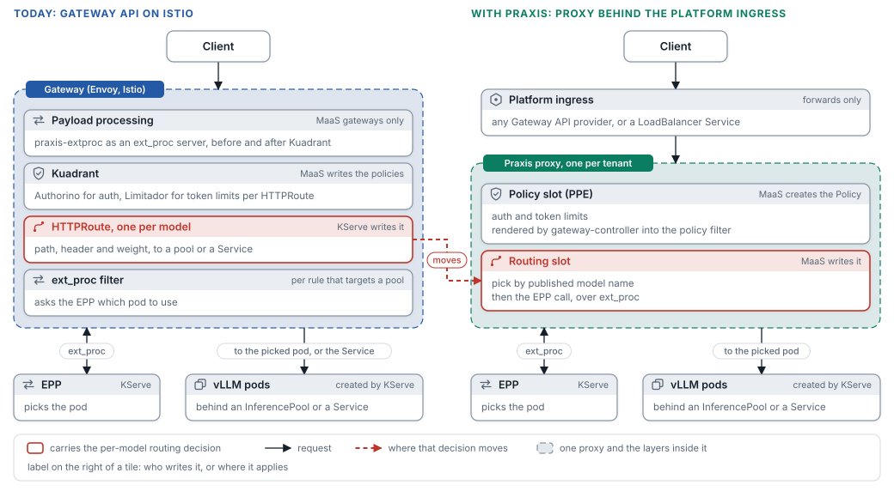
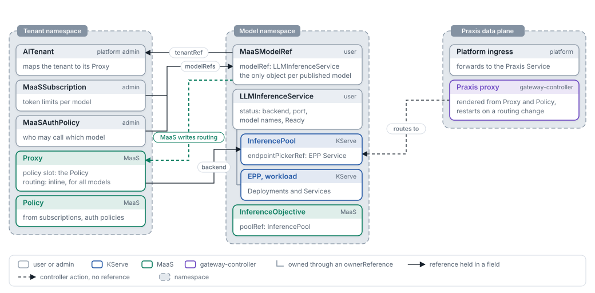

# Routing MaaS-published KServe models through Praxis

| | |
|---|---|
| Date | 2026-11-20 |
| Scope | Model Serving (KServe), Models-as-a-Service (MaaS), AI Gateway |
| Status | Approved |
| Authors | |
| Supersedes | N/A |
| Superseded by: | N/A |
| Tickets | |
| Other docs: | [KServe, MaaS and Praxis integration](https://bartoszmajsak.github.io/kserve-praxis-integration/) |

## What

The data plane moves from Gateway API on Istio to Praxis. The decision covers how a KServe `LLMInferenceService` that is published through MaaS is served in that setup: what KServe publishes about the service, which component writes its routing in Praxis, and what users write. KServe publishes the backend in the `LLMInferenceService` status, MaaS writes the routing into the `Proxy` of the tenant, and `MaaSModelRef` stays the object users write. The `ModelProvider` API can be adopted later.

## Why

Moving the data plane from Gateway API on Istio to Praxis changes how a KServe `LLMInferenceService` receives traffic. The move exposes problems in the integration between MaaS and KServe. A status contract on the `LLMInferenceService`, with MaaS as the owner of the routing, can help in the overall migration process.

[`gateway-controller`](https://github.com/praxis-proxy/gateway-controller) is not an ingress controller (yet?). It configures a Praxis proxy that is deployed behind the platform's existing ingress. Currently, that ingress ("any GWAPI provider, or none") "just forwards to it". A Gateway can still be the entry point and forward all traffic to Praxis. **The per-model HTTPRoute is removed**. Praxis routes on the `model` field of the request body, and ["no route is ever written"](https://github.com/praxis-proxy/gateway-controller/blob/f6a12554d9294130010ed16abea775657914bb6f/docs/design/api.md?plain=1#L311).

<picture><source media="(prefers-color-scheme: dark)" srcset="figs/request-path-dark.svg"></picture>

Today the per-model routing decision is an HTTPRoute on the Gateway. KServe writes it and Istio answers with status. With Praxis it is proxy configuration keyed on the model name, and the ingress only forwards. The EPP and the pods are the same in both columns.

### Today: who does what, and why

- KServe writes the HTTPRoute, the `InferencePool`, the EPP and the Service. The route exposes the service, and KServe derives `Ready` and the URL from the route status.
- MaaS writes the `AuthPolicy` on the Gateway and a token rate limit policy on each model's HTTPRoute. Kuadrant enforces by attaching to Gateway API objects, so a per-model limit needs a per-model route.
- Istio implements the Gateway. It adds the `ext_proc` filter for rules that target a pool, and it writes the route and pool status.
- On MaaS tenant gateways `praxis-extproc` runs as an `ext_proc` server around Kuadrant. It reads the model name from the request body, among other payload processing.

### With Praxis: who does what, and why

- The platform ingress only forwards. The proxy is not tied to any Gateway API implementation.
- MaaS creates a `Proxy` and a `Policy` per tenant. The `Policy` is a separate object so MaaS can delegate edit access without exposing the `Proxy`.
- `gateway-controller` renders the Praxis config from the `Proxy` and the `Policy`. In the Praxis design a `ModelProvider` per model also feeds the routing, and its API is still open. The rendered config has exactly one owner.
- KServe still creates the EPP, the pool, the Service and the pods. Scheduling stays with the EPP.
- Nothing writes status back to the `LLMInferenceService`. KServe readiness reads route and pool status today, so that has to change.

### Shortcomings in today's integration

Currently, MaaS and KServe integrate through the HTTPRoute and not through a defined contract. MaaS looks up the route, attaches its policies to it and derives the tenant from it. KServe publishes the status MaaS needs only while a route exists. Praxis removes the route, so the items below have to be fixed before a service can be served through Praxis.

| Shortcoming | What it causes | Fix |
|---|---|---|
| MaaS reads KServe's HTTPRoute. There is no single contract on the `LLMInferenceService` status. | MaaS finds the route by label, checks its parent Gateway and takes the hostname from it. 42 places in the MaaS code depend on an HTTPRoute or a Gateway. Without the route a `MaaSModelRef` becomes `Pending` although the service is `Ready`. | MaaS reads the backend, the port, the model names and `Ready` from the service status, and nothing else. |
| KServe only publishes that status when a route exists. | Without a route `status.router` is empty, the address has no port and no model names, and a service with a scheduler never becomes `Ready`. | KServe publishes the same status with or without a route. |
| A MaaS policy is owned by a KServe object. | The per-model rate limit policy targets the HTTPRoute and has it as owner. Deleting the route deletes the limit. | MaaS generates per-model limits that do not attach to a route. This needs Praxis support first ([`policy#352`](https://github.com/praxis-proxy/policy/issues/352), [`policy#308`](https://github.com/praxis-proxy/policy/issues/308), or the `token_rate_limit` filter). |
| Tenant identity is bound to a Gateway. | An `AITenant` fails without a Gateway, and a model's tenant is looked up from its route's parent Gateway. The proposal allows an ingress with no Gateway API. | Keep the Gateway as the tenant's entry point, resolve the tenant from the service's `gateway.refs`, and point an `AITenant` at a `Proxy`. An ingress without Gateway API would need `spec.tenantRef`. |
| The model ID is only published on gateway addresses. | The ID clients send is a contract. MaaS takes it from `status.addresses[].models`, which KServe fills from gateway URLs only. Without a route MaaS rebuilds it from the spec, and AFAICT that misses a name set through a `baseRef` and LoRA adapter names. | KServe publishes served model names without a route. MaaS uses them as the routing key. |
| Which requests go through the EPP is only defined in the HTTPRoute. | KServe's route preset sends seven inference endpoints to the `InferencePool`, which means through the EPP, and every other path, such as `/v1/models`, directly to the workload Service. The service status names the pool, the EPP and the Service, and not which request paths belong to which. The preset is configuration and a service can carry its own route spec, so the list cannot be copied into MaaS. | KServe publishes in status which request paths go through the EPP and which go to the Service directly. MaaS writes the routing from it. |
| Canary weights only exist on a route. | `group` and `weight` are fields of `spec.router.route`, and their status needs a route. `MaaSModelRef` has no weight. A service without a route cannot take part in a canary. | `group` and `weight` stay in `spec.router.route`. KServe publishes them in status when the HTTPRoute is not created, and MaaS reads them from there. |

## Goals

- A model published through MaaS is served through Praxis.
- Users and the dashboard keep writing the same objects. Clients keep the hostname, the request URL with the model in the body, and the model ID.
- MaaS and KServe integrate through one contract, the `LLMInferenceService` status, which does not depend on how the data plane routes. Every object has one writer.
- Upstream KServe needs no Praxis types and no tenant concept.
- The first step does not wait for APIs that are still open in Praxis, and the `ModelProvider` can be adopted later without a user-facing change.
- A tenant can move in stages and be rolled back, and the preparation can start before Praxis is ready.

## Non-Goals

- The move to Praxis itself. It is the starting point and is not decided here.
- Services that are not published through MaaS. How they are served is open and is not decided here.
- Gateway API support in Praxis, or a translation of the HTTPRoute that KServe generates.
- Replacing `MaaSModelRef` as the object users write, or defining the `ModelProvider` API.
- Weighted routing between services in the first step. The weights stay on the service and KServe publishes them in status, so they are available when Praxis routes by weight.
- An ingress without Gateway API. The tenant Gateway stays in front of the proxy.
- Per-model path URLs of the form `/<namespace>/<name>/v1/...` through Praxis.
- Moving a single model. The unit of the cut-over is the tenant.

## How

We propose to keep `MaaSModelRef` as the only object a user writes to publish a model. KServe publishes what it already knows about the service in its status: the backend, the port, the served model names and `Ready`, with or without a route. MaaS reads that status and writes the routing of each published model into the `Proxy` of the tenant, next to the policy slot, and `gateway-controller` renders it. No `ModelProvider` is created.

The status also has to say which request paths go through the EPP and which go to the workload Service directly. That split is only defined in the HTTPRoute today, and the routing MaaS writes needs both kinds of entries.

<picture><source media="(prefers-color-scheme: dark)" srcset="figs/relationships-option-3-dark.svg"></picture>

No object represents the routing of a single model. It is part of the `Proxy`, which MaaS already writes. The marks are explained in [Alternatives](alternatives.md).

### Who does what, and why

- The user writes the same `MaaSModelRef` as today. Its spec needs no new field, because the backend, the port and the model names come from the service status. Its `httpRoute*` status fields have no source without a route.
- KServe creates the pool, the EPP and the workload, and publishes the backend, the port, the served model names and `Ready` in status. It creates nothing in the tenant namespace and needs no tenant.
- MaaS reads that status and writes the routing of every published model of a tenant into the tenant's `Proxy`, next to the policy slot. The proposal allows this: when the routing slot is not delegated, "routing stays MaaS-defined". MaaS creates the `Policy` from the subscriptions and the auth policies.
- `gateway-controller` renders the `Proxy` and the `Policy`. It does not need the `ModelProvider` type, which is not implemented yet ([`#40`](https://github.com/praxis-proxy/gateway-controller/issues/40), [`#42`](https://github.com/praxis-proxy/gateway-controller/issues/42)).

### The service spec and the Gateway

- `spec.router.route` stays in the service spec, with `group` and `weight` when a canary needs them. KServe publishes them in status, and it does not create the HTTPRoute for a service that is served through Praxis.
- `spec.router.gateway.refs` stays in use. MaaS resolves the tenant from it, and KServe finds the Gateway of the service through it.
- KServe recognises a Praxis-based deployment from the Gateway the service references. How the Gateway shows that is an open question.

### Benefits

- **One contract between MaaS and KServe**: the `LLMInferenceService` status. MaaS no longer depends on the HTTPRoute, its labels, its parent Gateway or its hostnames.
- **One writer per object.** MaaS writes every object in the tenant namespace, and KServe writes only next to the service.
- **Dependencies in one direction.** KServe needs no tenant information, creates no Praxis object and does not depend on a Praxis CRD being installed, so upstream KServe stays vendor-neutral.
- **No dependency on the `ModelProvider` API.** It is open with no milestone, and this option needs the `Proxy` and the `Policy` only.
- **Nothing changes in what users and the dashboard write.** `MaaSModelRef` needs no new spec field.
- **Several tenants per service need no extra API.** One service can be published to several tenants today, with one `MaaSModelRef` each.
- **Adopting the `ModelProvider` later needs no change for users or for KServe.** The contract with KServe and the user-facing objects stay the same.

### Changes in upstream KServe

KServe creates no new objects. It has to publish complete status for a service without a route: today such a service with a scheduler never becomes `Ready`, and its status does not include the pool. We read this from [`kserve/kserve`](https://github.com/kserve/kserve) master at [`cdbe986058`](https://github.com/kserve/kserve/commit/cdbe9860583e36f29d46a58179d86299e8faa41d). The sizes are estimates from reading the code. None of it has been implemented.

| Change | Today | Size |
|---|---|---|
| Mark a service with a scheduler and no route `Ready`, and publish its pool in `status.router.scheduler` with the v1 API group. One PR. | It stays `InferencePoolReady=False` with reason `WaitingForGateway`, and `status.router` is cleared. Both changes have to ship together because MaaS interprets "`Ready` and no pool in status" as a service without a scheduler. | Small, status only |
| Publish which request paths go through the EPP and which go to the workload Service directly. | The split exists only in the route preset. Thirteen of its sixteen rules send seven inference endpoints, such as `/v1/chat/completions`, to the `InferencePool`, and [three catch-all rules](https://github.com/kserve/kserve/blob/cdbe9860583e36f29d46a58179d86299e8faa41d/config/llmisvcconfig/config-llm-router-route.yaml#L439-L495) send every other path, such as `/v1/models`, to the workload Service. The status names the pool, the EPP and the Service, and no paths. | Medium, API change |
| Publish served model names on the address of a service with no route. | `status.addresses[].models` is filled from gateway URLs only. | Small |
| Add the port to that address, and clear `status.url` when the route is removed. | The address is the workload Service host with no port, and the Service listens on 8000. `status.url` is only written when there is a route, so AFAICT it keeps its old value once the route is removed. | Small |
| Skip the managed HTTPRoute for a Gateway that is in front of a Praxis proxy, and treat the service as one with no route. | The route is always rendered when `spec.router.route` is set. Which property of the Gateway shows that is to be confirmed. Reading a property of the parent Gateway has a precedent: `serving.kserve.io/model-based-routing-only` is read from the parent Gateway. | Small to medium |
| Publish `group` and `weight` in status when the HTTPRoute is not created. | They are fields of `spec.router.route`, which stays in the spec. The group status assumes a route, and `status.router` is cleared without one. | Medium |
| No change for the workload Service. | It is already in `status.workloads.service`, and a service with no scheduler and no route is already `Ready`. | None |

- Open PR [`kserve/kserve#5972`](https://github.com/kserve/kserve/pull/5972) covers a service with `gateway.refs` and no route (issue [`#5986`](https://github.com/kserve/kserve/issues/5986)). A service with no route and no refs is not covered.
- Do not make readiness wait for Praxis. MaaS waits for `Ready` before it writes the routing entry, which would create a circular dependency.
- ODH build: reconcile the scheduler before the Kuadrant auth check. Today the check returns first, so with the `AuthPolicy` CRD gone no EPP is created for a service with auth enabled.
- ODH build: give strict NetworkPolicy a way to allow the proxy's namespace. Today it takes the allowed namespaces from Gateway references only.

### Changes in MaaS

MaaS has the larger share of the work. It derives nearly all model information from the HTTPRoute today, so that dependency has to be removed first. Most rows are needed for any integration with Praxis, and only the last four follow from MaaS writing the routing. This comes from [`opendatahub-io/models-as-a-service`](https://github.com/opendatahub-io/models-as-a-service) at [`e0afdbc`](https://github.com/opendatahub-io/models-as-a-service/commit/e0afdbc2fba21070ec56e67a340f221bc448e3be).

| Change | Today | Size |
|---|---|---|
| Read the backend, the port, the model names and `Ready` from the `LLMInferenceService` status. Stop looking up the HTTPRoute. | MaaS finds the route by label and requires the tenant Gateway as its parent. No route means `Pending`, "Waiting for HTTPRoute to be created". | Medium |
| Take a model's endpoint from the tenant's ingress host, and rename the `httpRoute*` status fields. | The endpoint comes from route hostnames or Gateway listeners. `maas-api` builds the model URL from `status.httpRouteHostnames[0]`. | Medium, API change |
| Resolve the tenant from the service's `gateway.refs` when `spec.tenantRef` is empty. | It is looked up from the route's parent Gateway. The dashboard never sets `tenantRef`, so it has to stay optional. | Small |
| Write the `InferenceObjective` without checking the route. | It is only written when the model's route is on the tenant Gateway. | Small |
| Generate per-model token limits that do not attach to a route. | The rate limit policy targets the HTTPRoute and has it as owner. Praxis has to support a limit per model first. | New |
| Generate a Praxis `Policy` from `MaaSAuthPolicy`. | It becomes a Kuadrant `AuthPolicy` that targets the tenant Gateway. Kubernetes token auth waits on [`policy#213`](https://github.com/praxis-proxy/policy/issues/213). | New |
| Let an `AITenant` work without a Gateway, and create a `Proxy` and a `Policy` for it. | The tenant is set to `Failed` when its Gateway check fails, and it has no field for a `Proxy`. | New |
| Decide where `maas-api` is served. | Through the tenant Gateway, by its own HTTPRoute. Its paths include `/maas-api`, `/v1/models` and `/v1/api-keys`. | Decision |
| Write a routing entry for each `MaaSModelRef` into the tenant's `Proxy`, and remove it when the service stops or is deleted. | MaaS already does the same for an `InferenceObjective` per pool. It needs RBAC and a watch for the Praxis types. | Medium |
| Write two kinds of entries for a model with a scheduler: the inference endpoints through the EPP, and every other path to the workload Service. | MaaS has no code for this, because the HTTPRoute carries the split today. The paths have to come from the service status, and not from a list in MaaS. | New |
| Use the current model ID as the routing key. | `ResolveModelAlias` takes it from the service's status addresses, or builds `publishers/{ns}/models/{name}` from the spec. | Small |
| Read canary weights from the service status. | `MaaSModelRef` has no weight, and two refs in one tenant with the same model ID are a conflict. | New, when Praxis routes by weight |

- MaaS has no Praxis control-plane code today. Nothing in the repository refers to `praxis.io`.
- Grid in [`odh-model-controller`](https://github.com/opendatahub-io/odh-model-controller) needs the first change too: it stops publishing a provider when `status.router` is empty.

### Dependencies

Delivering the decision depends on work in Praxis that is not ours. The cut-over of a tenant waits for it. The dates and the stages are in [Migration](migration.md).

- `gateway-controller` renders and deploys the proxy from a `Proxy` and a `Policy`. This is tracked in [`gateway-controller#14`](https://github.com/praxis-proxy/gateway-controller/issues/14) to [`#17`](https://github.com/praxis-proxy/gateway-controller/issues/17) and in the draft [`gateway-controller#82`](https://github.com/praxis-proxy/gateway-controller/pull/82).
- The EPP client of Praxis selects its target per model, supports TLS and sends response bodies to the EPP. Services with a scheduler need it. No issue is open for it, and [`ai#165`](https://github.com/praxis-proxy/ai/issues/165) is closed as completed.
- The policy engine supports Kubernetes token authentication and authorization ([`policy#213`](https://github.com/praxis-proxy/policy/issues/213), [`policy#214`](https://github.com/praxis-proxy/policy/issues/214)), a token limit per model ([`policy#352`](https://github.com/praxis-proxy/policy/issues/352), [`policy#308`](https://github.com/praxis-proxy/policy/issues/308)) and limit counters shared between replicas ([`policy#127`](https://github.com/praxis-proxy/policy/issues/127)).

## Open Questions

- **How KServe recognises a Gateway that is in front of a Praxis proxy.** KServe already fetches the Gateway and its `GatewayClass` for every parent of a route, so the lookup is available. Which property carries the signal is not decided. The `GatewayClass` identifies Praxis only if that Gateway has a class of its own: a Praxis class exists in the Rust `operator`, named `praxis` with the controller `praxis.sh/gateway-controller`, and a Gateway from another provider carries the class of that provider. An annotation on the Gateway is the other candidate, as KServe reads `serving.kserve.io/model-based-routing-only` from it today. The integration proposal in `gateway-controller` names neither and leaves the question open ([PR #26](https://github.com/praxis-proxy/gateway-controller/pull/26)).
- **How services that are not published through MaaS are served.** They have no routing entry in this decision.
- **Where in the status KServe publishes the request paths that go through the EPP.** The fields are not designed.
- **Where `maas-api` is served.** Today it has its own HTTPRoute on the tenant Gateway.
- **Whether the gateway-level Kuadrant policies are removed at the cut-over of a tenant or after it.** They apply to the forwarding route as well.

## Alternatives

Two other ways to integrate KServe and MaaS with Praxis were considered.

### Option 1: KServe creates the ModelProvider

Option 1 replaces the per-model HTTPRoute with a `ModelProvider` that KServe creates in the tenant namespace. MaaS completes the object by setting `status.proxyRef`, and `gateway-controller` renders the routing from it. Its advantage is that it needs no new status contract, because the component that knows the backend writes the provider. It is not preferred for these reasons.

- KServe writes into a namespace it does not manage. An `ownerReference` cannot cross namespaces, so nothing ties the lifetime of the provider to the service.
- KServe has no tenant. An `LLMInferenceService` has no tenant field, and resolving the tenant "through gatewayRef" requires a Gateway.
- One object has three writers, and two of them write its status.
- `MaaSModelRef`, `MaaSSubscription` and `MaaSAuthPolicy` have no defined role. One service can be published to several tenants today, which a single `aiTenantRef` cannot express.
- `inferencePoolRef` holds only a name, while the pool is in another namespace.
- MaaS still has to stop depending on the HTTPRoute, so the work in MaaS is not smaller.

### Option 2: MaaS creates the ModelProvider

In option 2 KServe publishes the backend in the `LLMInferenceService` status, and MaaS creates a `ModelProvider` for each `MaaSModelRef`. Every object in the tenant namespace then has one writer, and KServe writes only in the model namespace. It needs the `ModelProvider` API, which is open with no milestone ([`#40`](https://github.com/praxis-proxy/gateway-controller/issues/40), [`#42`](https://github.com/praxis-proxy/gateway-controller/issues/42)), so it is not preferred now. The preferred option uses the same contract with KServe and reaches this state when the API is adopted. These points are open in it.

- The provider references a backend in another namespace. The Praxis design leaves that access to NetworkPolicy and admission policy.
- No `ownerReference` links a `MaaSModelRef` to its provider either, because they are in different namespaces. The finalizer covers deletion.
- When a service is stopped or deleted, KServe removes the pool and the Service immediately, but the provider stays in the Praxis configuration until MaaS removes it.
- Canary weights need an owner: they are either copied from the service or defined in MaaS.

### Comparison

The table lists the relationships that change between the current setup, the two alternatives and the preferred option, which is described in [Decision](decision.md).

| Relationship | Today | Option 1 | Option 2 | Preferred |
|---|---|---|---|---|
| Routing entry for a model | HTTPRoute, created by KServe | `ModelProvider`, created by KServe | `ModelProvider`, created by MaaS | Routing inline in the tenant's `Proxy`, written by MaaS |
| Its owner | `LLMInferenceService`, through an `ownerReference` | None. The service is in another namespace | MaaS, through the finalizer on `MaaSModelRef` | The `Proxy`, which MaaS owns |
| Its writers | KServe for the spec, Istio for the status | KServe for the spec, MaaS and `gateway-controller` for the status | MaaS for the spec, `gateway-controller` for the status | MaaS for the spec, `gateway-controller` for the status |
| Source of the tenant | `MaaSModelRef.spec.tenantRef`, or the route's parent Gateway | A lookup "through gatewayRef" from the service, not defined | `MaaSModelRef.spec.tenantRef` | `MaaSModelRef.spec.tenantRef` |
| What MaaS reads from KServe | The HTTPRoute and the service status | Not specified | The service status only | The service status only |
| What KServe has to know | The tenant Gateway | The tenant, and the Praxis `ModelProvider` type | Nothing new | Nothing new |
| Per-model token limit | `TokenRateLimitPolicy` owned by the HTTPRoute | Rules in the `Policy` | Rules in the `Policy` | Rules in the `Policy` |
| Writes outside the writer's own namespaces | MaaS writes policies into the model and the gateway namespaces | KServe writes the provider into the tenant namespace | MaaS writes the `InferenceObjective` into the model namespace | MaaS writes the `InferenceObjective` into the model namespace |

## Security and Privacy Considerations

- Authentication and authorization move from Kuadrant policies on the Gateway to a Praxis `Policy`, which MaaS generates from the same `MaaSAuthPolicy` and `MaaSSubscription` objects. The policy engine has no Kubernetes token authentication yet ([`policy#213`](https://github.com/praxis-proxy/policy/issues/213)), so a tenant cannot be cut over before it has.
- KServe gets no new permissions. It writes only in the model namespace and needs no access to the tenant namespace or to Praxis types.
- MaaS needs permissions for the Praxis types in the tenant namespace, and it keeps writing the `InferenceObjective` into the model namespace.
- The proxy of a tenant sends requests to pods in the model namespaces. The Praxis design leaves that access to NetworkPolicy and admission policy, and on the ODH build strict NetworkPolicy has to allow the namespace of the proxy.
- AFAICT the Praxis `ext_proc` client has no TLS, while the TLS of the EPP is controlled by a cluster-wide KServe setting. How the proxy connects to the EPP is therefore unresolved for services with a scheduler.
- No new data is stored. The proxy reads the request body to find the model name, as `praxis-extproc` does on MaaS gateways today.

## Risks

- In the current draft a routing change rolls the proxy pods. A `Proxy` has no field for a mounted routing file, so the routing is part of the rendered configuration. The draft that renders the proxy ([`gateway-controller#82`](https://github.com/praxis-proxy/gateway-controller/pull/82)) sets a revision of that configuration as an annotation on the pod template, so the Deployment rolls on every change.
- Today the routing covers services without a scheduler, and no canary. The Praxis EPP client takes one static target and has no TLS. The alternatives have the same limit until that client is extended.
- All models of a tenant are in one object, so every publish and unpublish is a write to the same `Proxy`.
- The routing renderer in MaaS is discarded when the `ModelProvider` arrives. MaaS then creates one provider per `MaaSModelRef`.
- A service without a `MaaSModelRef` has no routing entry. How services that are not published through MaaS are served is open.
- When an `LLMInferenceService` is stopped or deleted, KServe removes the pool and the Service immediately, but the routing entry stays in the Praxis configuration until MaaS removes it. Until then Praxis routes requests to a backend that no longer exists, so MaaS has to remove the entry as soon as the service stops.
- Canary weights stay on the service, in `spec.router.route`, and MaaS reads them from the service status. We would not add a weight field to `MaaSModelRef`, because it would compete with the weight of a `ModelProvider` later.

## Stakeholder Impacts

| Group | Key Contacts | Date | Impacted? |
|---|---|---|---|
| Model Serving (KServe) | | | Publishes complete status for a service without a route and the request paths that go through the EPP, and skips the HTTPRoute for a Gateway that is in front of a Praxis proxy. |
| Models-as-a-Service (MaaS) | | | Reads the service status in place of the HTTPRoute, writes the routing into the `Proxy` of the tenant and generates the Praxis `Policy`. It has the larger share of the work. |
| AI Gateway (Praxis) | | | `gateway-controller` renders and deploys the proxy from the `Proxy` and the `Policy`. The EPP client and the policy engine have open work. |
| Dashboard | | | No change while the service spec keeps `route` and `gateway.refs`. The `HTTPRoute` column and two progress steps disappear. |
| Users and API clients | | | They keep the objects they write, the hostname and the model IDs. Per-model path URLs stop working. |

## References

- [Decision](decision.md), with the impact on users and the dashboard
- [Alternatives](alternatives.md), with a figure of the custom resources of each option
- [Context](context.md), with the state of Praxis and its Gateway API support
- [Migration](migration.md), which is a work in progress
- [praxis-proxy/gateway-controller](https://github.com/praxis-proxy/gateway-controller) and its [design](https://github.com/praxis-proxy/gateway-controller/blob/f6a12554d9294130010ed16abea775657914bb6f/docs/design/api.md)

## Reviews

| Reviewed by | Date | Notes |
|---|---|---|
| | | |
