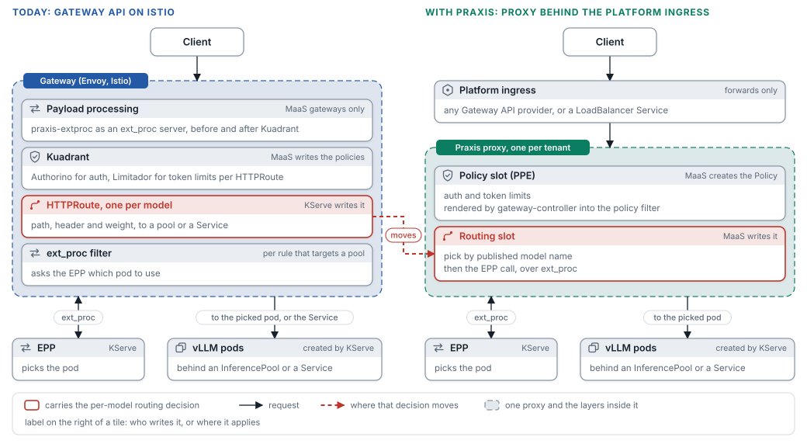
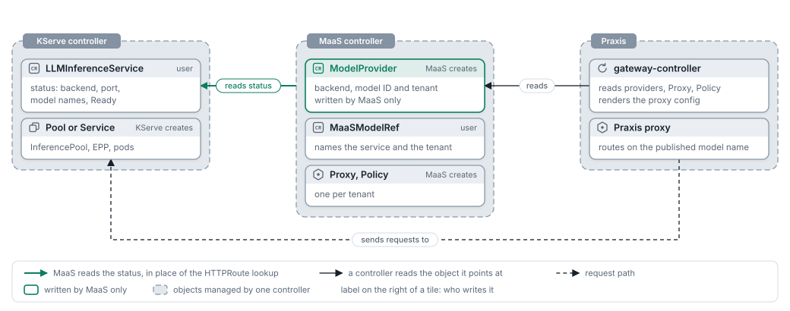

# Praxis ingress paths

Praxis data plane, repositories read 2026-11-19.

Moving the data plane from Gateway API on Istio to Praxis changes how a KServe `LLMInferenceService` receives traffic. The move exposes problems in the integration between MaaS and KServe. A status contract on the `LLMInferenceService`, with MaaS as the owner of the `ModelProvider`, can help in the overall migration process.

| Topic | Summary | Detail |
|---|---|---|
| Problem | MaaS and KServe integrate through the HTTPRoute | MaaS looks up the route, attaches its policies to it and derives the tenant from it. Praxis removes the per-model route. |
| What can help | A status contract, and MaaS owns the provider | KServe publishes the backend, the port, the model names and `Ready` in the service status, with or without a route. MaaS creates the `ModelProvider` from it. |
| Migration | Route and provider in parallel | Both can point at the same backend, so the cutover can overlap. MaaS has to stop depending on the HTTPRoute first, and TLS to the EPP blocks the overlap today. |

## Praxis in the request path

Despite its name, [`gateway-controller`](https://github.com/praxis-proxy/gateway-controller) is not an ingress controller. It configures a Praxis proxy that is deployed behind the platform's existing ingress. According to the proposal, that ingress ("any GWAPI provider, or none") "just forwards to it".

- A Gateway can still be the entry point and forward all traffic to Praxis. The per-model HTTPRoute is removed. Praxis routes on the `model` field of the request body, and "no route is ever written" ([`docs/design/api.md:311`](https://github.com/praxis-proxy/gateway-controller/blob/f6a12554d9294130010ed16abea775657914bb6f/docs/design/api.md?plain=1#L311)).
- On `main` ([`f6a1255`](https://github.com/praxis-proxy/gateway-controller/commit/f6a12554d9294130010ed16abea775657914bb6f)) the controller has four status-only reconcilers: `Proxy`, `Policy`, `Tenant`, `AIGateway`. It has no Gateway API dependency, and nothing in it deploys or exposes a proxy yet. The `ModelProvider` API is still an open issue too ([`#40`](https://github.com/praxis-proxy/gateway-controller/issues/40), [`#42`](https://github.com/praxis-proxy/gateway-controller/issues/42)).
- The `ModelProvider` API is not settled. The proposal and the design docs in the repository describe different fields, and neither type exists in code.

<picture><source media="(prefers-color-scheme: dark)" srcset="figs/request-path-dark.svg"></picture>

Today the per-model routing decision is an HTTPRoute on the Gateway. KServe writes it and Istio answers with status. With Praxis it is proxy configuration keyed on the model name, and the ingress only forwards. The EPP and the pods are the same in both columns.

### Today: who does what, and why

- KServe writes the HTTPRoute, the `InferencePool`, the EPP and the Service. The route exposes the service, and KServe derives `Ready` and the URL from the route status.
- MaaS writes the `AuthPolicy` on the Gateway and a token rate limit policy on each model's HTTPRoute. Kuadrant enforces by attaching to Gateway API objects, so a per-model limit needs a per-model route.
- Istio implements the Gateway. It adds the `ext_proc` filter for rules that target a pool, and it writes the route and pool status.
- On MaaS tenant gateways `praxis-extproc` runs as an `ext_proc` server around Kuadrant. It reads the model name from the request body, among other payload processing.

### With Praxis: who does what, and why

- The platform ingress only forwards. The proxy is not tied to any Gateway API implementation.
- MaaS creates a `Proxy` and a `Policy` per tenant. The `Policy` is a separate object so MaaS can delegate edit access without exposing the `Proxy`.
- `gateway-controller` renders the Praxis config from the `Proxy`, the `Policy` and the `ModelProvider`s. The rendered config has exactly one owner.
- KServe still creates the EPP, the pool, the Service and the pods. Scheduling stays with the EPP.
- Nothing writes status back to the `LLMInferenceService`. KServe readiness reads route and pool status today, so that has to change.

## Problems in today's integration

MaaS and KServe integrate through the HTTPRoute today. MaaS looks up the route, attaches its policies to it and derives the tenant from it, and KServe publishes the status MaaS needs while a route exists. Praxis removes the per-model route, so the move exposes the items below. Each of them needs a solution before a service can be served through Praxis.

### Between MaaS and KServe

| Shortcoming | What it causes | Fix |
|---|---|---|
| MaaS reads KServe's HTTPRoute. There is no single contract on the `LLMInferenceService` status. | MaaS finds the route by label, checks its parent Gateway and takes the hostname from it. 42 places in the MaaS code depend on an HTTPRoute or a Gateway. Without the route a `MaaSModelRef` becomes `Pending` although the service is `Ready`. | MaaS reads the backend, the port, the model names and `Ready` from the service status, and nothing else. |
| KServe only publishes that status when a route exists. | Without a route `status.router` is empty, the address has no port and no model names, and a service with a scheduler never becomes `Ready`. | KServe publishes the same status with or without a route. |
| A MaaS policy is owned by a KServe object. | The per-model rate limit policy targets the HTTPRoute and has it as owner. Deleting the route deletes the limit. | MaaS generates per-model limits that do not attach to a route. This needs Praxis support first ([`policy#352`](https://github.com/praxis-proxy/policy/issues/352), [`policy#308`](https://github.com/praxis-proxy/policy/issues/308), or the `token_rate_limit` filter). |
| Tenant identity is bound to a Gateway. | An `AITenant` fails without a Gateway, and a model's tenant is looked up from its route's parent Gateway. The proposal allows an ingress with no Gateway API. | Keep the Gateway as the tenant's entry point, resolve the tenant from the service's `gateway.refs`, and point an `AITenant` at a `Proxy`. An ingress without Gateway API would need `spec.tenantRef`. |
| The model ID is only published on gateway addresses. | The ID clients send is a contract. MaaS takes it from `status.addresses[].models`, which KServe fills from gateway URLs only. Without a route MaaS rebuilds it from the spec, and AFAICT that misses a name set through a `baseRef` and LoRA adapter names. | KServe publishes served model names without a route. MaaS copies them into `publishedName`. |
| Canary weights only exist on a route. | `group` and `weight` are fields of `spec.router.route`, and their status needs a route. `MaaSModelRef` has no weight. A service without a route cannot take part in a canary. | Either KServe allows `group` and `weight` without a route, or MaaS holds the weights. |

### In Praxis

The migration also depends on work in Praxis that is still open. It is outside our control.

| Shortcoming | What it causes | Fix |
|---|---|---|
| The EPP client does not cover the endpoint picker protocol. | It rejects the EPP's list of fallback endpoints, never reports which pod served the request and does not send response bodies to the EPP. AFAICT it has no TLS. It is off in published builds. No issue tracks any of this, and [`ai#165`](https://github.com/praxis-proxy/ai/issues/165) is closed as completed. | File the issues under [`gateway-controller#24`](https://github.com/praxis-proxy/gateway-controller/issues/24), and test against the real EPP with KServe's presets. |
| The policy engine cannot replace Kuadrant for MaaS yet. | No Kubernetes token auth ([`policy#213`](https://github.com/praxis-proxy/policy/issues/213)), no limit per model ([`policy#352`](https://github.com/praxis-proxy/policy/issues/352)), counters per replica ([`policy#127`](https://github.com/praxis-proxy/policy/issues/127)), and the FIPS image is built without the policy filter. The MaaS team's own POC lists these. | Track those four, and decide whether token limits are enforced by the policy engine or by the `token_rate_limit` filter. |
| The control plane is not built. | `gateway-controller` has no `ModelProvider` type and does not render or deploy a proxy yet ([`#14`](https://github.com/praxis-proxy/gateway-controller/issues/14) to [`#17`](https://github.com/praxis-proxy/gateway-controller/issues/17), [`#40`](https://github.com/praxis-proxy/gateway-controller/issues/40), [`#42`](https://github.com/praxis-proxy/gateway-controller/issues/42)). | No action on our side. Track it. The [`v1.0.0` milestone](https://github.com/praxis-proxy/gateway-controller/milestone/1) is due 2027-01-20. |

## Ownership of the ModelProvider

A `ModelProvider` connects a tenant's Praxis proxy to a model backend. Creating it requires three inputs: the tenant, the backend and the model ID. MaaS holds the tenant, because a model is published through a `MaaSModelRef`. KServe holds the backend and the model names. If KServe publishes its part in the `LLMInferenceService` status, MaaS can create and own the provider from it.

<picture><source media="(prefers-color-scheme: dark)" srcset="figs/modelprovider-ownership-dark.svg"></picture>

Dependencies run in one direction. `gateway-controller` reads the objects MaaS creates, MaaS reads the service status, and KServe depends on neither. The dashed line is the request path.

### Who does what, and why

- The user writes the `LLMInferenceService` and publishes it with a `MaaSModelRef`, as today.
- KServe creates the pool, the EPP and the Service, and publishes the backend, the port, the served model names and `Ready` in status. Only KServe has this information, and none of it requires a tenant.
- MaaS reads that status and creates the `ModelProvider` together with the tenant's `Proxy` and `Policy`. It already has the tenant on `MaaSModelRef` and manages the tenant's objects, so the provider has a single writer.
- `gateway-controller` reads the `ModelProvider`, the `Proxy` and the `Policy`, and renders the proxy configuration. It does not have to read MaaS or KServe types.

### Benefits

- One owner per object. MaaS is the only writer of the `ModelProvider`, so no controller waits for another to complete it.
- One contract between MaaS and KServe: the `LLMInferenceService` status. MaaS no longer depends on the HTTPRoute, its labels, its parent Gateway or its hostnames.
- Dependencies in one direction. KServe needs no tenant information, creates no Praxis object and does not depend on a Praxis CRD being installed, so upstream KServe stays vendor-neutral.
- No cross-namespace writes by KServe. The Praxis design places the provider in the tenant namespace, which MaaS manages.
- Several tenants per service need no extra API. One service can be published to several tenants today, with one `MaaSModelRef` each, which gives one provider per tenant.
- Incremental migration. The route and the provider can reference the same backend, so a model is switched by creating the provider and rolled back by deleting it.
- It follows existing practice. MaaS already reads `status.router.scheduler.inferencePool` and writes an `InferenceObjective` per pool, and the Praxis design has the MaaS controller generate `Model` and `ModelProvider` from a `MaaSModelRef` ([`api.md`, section 9.1](https://github.com/praxis-proxy/gateway-controller/blob/f6a12554d9294130010ed16abea775657914bb6f/docs/design/api.md#91-how-maas-crds-lower-onto-the-ai-gateway-layer)).

### Costs and open points

- A service without a `MaaSModelRef` has no provider, so non-MaaS services remain on Gateway API with Kuadrant.
- Canary weights need an owner. They are either copied from `group` and `weight` on the service, or defined in MaaS. The Praxis design puts them on `Model.providers[]` and leaves weighting out of v1alpha1 scope.
- Nothing keeps a backend available while Praxis still routes to it. Stopping a service deletes the pool and the Service immediately, so MaaS has to handle stop and delete.
- The `ModelProvider` could replace `MaaSModelRef` altogether, with users writing the provider directly. That removes one object, but three points are undefined: how a provider in the tenant namespace references a backend in another namespace and who authorizes it, which component derives the backend from the service, and what `MaaSSubscription` and `MaaSAuthPolicy` reference in place of a `MaaSModelRef`.

## Gateway API support in Praxis

We checked whether Praxis has a Gateway API implementation that could serve the HTTPRoute KServe already generates. It does not have one we can rely on. The only Gateway API code is in the Rust [`operator`](https://github.com/praxis-proxy/operator), and new work happens in `gateway-controller`: rendering the Praxis config and deploying the proxy are tracked there ([`#14`](https://github.com/praxis-proxy/gateway-controller/issues/14) to [`#17`](https://github.com/praxis-proxy/gateway-controller/issues/17)). The design also rules out a separate Gateway API controller next to it, because the Gateway API implementation "must therefore be the same controller that implements the Praxis Core API" ([`api.md`, section 12](https://github.com/praxis-proxy/gateway-controller/blob/f6a12554d9294130010ed16abea775657914bb6f/docs/design/api.md#12-stance-on-gateway-api)). `gateway-controller` has no Gateway API code, and none of its [49 open issues](https://github.com/praxis-proxy/gateway-controller/issues) is about it.

The operator also cannot serve the HTTPRoute that KServe generates. It passes Gateway API HTTP conformance, core and extended, but thirteen of the sixteen rules in [KServe's route preset](https://github.com/kserve/kserve/blob/cdbe9860583e36f29d46a58179d86299e8faa41d/config/llmisvcconfig/config-llm-router-route.yaml) point at an `InferencePool`, and the operator accepts `core/Service` only ([`src/gateway_api/route_status.rs:142-148`](https://github.com/praxis-proxy/operator/blob/1a9f9d57cd6bf5362291bcf9e1655770747224a3/src/gateway_api/route_status.rs#L142-L148) at [`1a9f9d5`](https://github.com/praxis-proxy/operator/commit/1a9f9d57cd6bf5362291bcf9e1655770747224a3)).

| KServe's route preset uses | Praxis operator (being replaced) | AI Gateway API (design) |
|---|---|---|
| Path and header matches | Yes, prefix and exact | No surface, routes on body `model` |
| Prefix rewrite, 14 of 16 rules | Yes | None |
| Weighted backendRefs | Yes | On `Model.providers[]`, out of v1alpha1 scope |
| Request timeout, 4 rules at 600s | Partial | None |
| `InferencePool` backendRef, 13 of 16 rules | No: `InvalidKind`, generated 500 | Not in the design, only in [PR #26](https://github.com/praxis-proxy/gateway-controller/pull/26) |
| `Service` backendRef, 3 rules | Yes, plaintext upstream only | `backend.serviceRef` |
| Pool parent status for readiness | No | No |
| TLS to pods and to the EPP | Core supports upstream TLS, operator does not emit it | Unspecified |

- The operator has no tags, no releases and no users in the demos. A maintainer wrote on 2026-11-13 that they are "considering archiving" it once `gateway-controller` covers conformance.
- No HTTPRoute support is being built for Praxis today. The AI Gateway API has no Gateway API dependency by design. Gateway API support is only mentioned as something for later ("When we implement GWAPI for praxis", [`policy#104`](https://github.com/praxis-proxy/policy/issues/104#issuecomment-6942155676), 2026-11-17), with no issue and no date.
- The HTTPRoute does not need translating. Most of it is specific to Gateway API. Five pieces of information have to be passed on, and only KServe has them: the backend (pool or Service, name, port), served model names including LoRA adapters, backend TLS and its trust anchor, lifecycle (ready, stopped, deleting), and `group` and `weight` if the service stays the canary API.
- Not available unless Praxis implements them: the catch-all rules that send non-inference paths such as `/v1/models` to the Service, and the unlimited request timeout.

## Changes in upstream KServe

KServe creates no new objects. It has to publish complete status for a service without a route: today such a service with a scheduler never becomes `Ready`, and its status does not include the pool. We read this from [`kserve/kserve`](https://github.com/kserve/kserve) master at [`cdbe986058`](https://github.com/kserve/kserve/commit/cdbe9860583e36f29d46a58179d86299e8faa41d), in the files under `pkg/controller/v1alpha2/llmisvc/`. The sizes are estimates from reading the code. None of it has been implemented.

| Change | Today | Size |
|---|---|---|
| Mark a service with a scheduler and no route `Ready`, and publish its pool in `status.router.scheduler` with the v1 API group. One PR. | It stays `InferencePoolReady=False` with reason `WaitingForGateway` ([`router.go:801`](https://github.com/kserve/kserve/blob/cdbe9860583e36f29d46a58179d86299e8faa41d/pkg/controller/v1alpha2/llmisvc/router.go#L801), [`:975`](https://github.com/kserve/kserve/blob/cdbe9860583e36f29d46a58179d86299e8faa41d/pkg/controller/v1alpha2/llmisvc/router.go#L975)), and `status.router` is cleared ([`router.go:484`](https://github.com/kserve/kserve/blob/cdbe9860583e36f29d46a58179d86299e8faa41d/pkg/controller/v1alpha2/llmisvc/router.go#L484)). Both changes have to ship together because MaaS interprets "`Ready` and no pool in status" as a service without a scheduler. | Small, status only |
| Publish served model names on the address of a service with no route. | `status.addresses[].models` is filled from gateway URLs only ([`router_discovery_filter.go:90-157`](https://github.com/kserve/kserve/blob/cdbe9860583e36f29d46a58179d86299e8faa41d/pkg/controller/v1alpha2/llmisvc/router_discovery_filter.go#L90-L157)). | Small |
| Add the port to that address, and clear `status.url` when the route is removed. | The address is the workload Service host with no port, and the Service listens on 8000 ([`router.go:493-500`](https://github.com/kserve/kserve/blob/cdbe9860583e36f29d46a58179d86299e8faa41d/pkg/controller/v1alpha2/llmisvc/router.go#L493-L500)). `status.url` is only written when there is a route ([`router.go:545-550`](https://github.com/kserve/kserve/blob/cdbe9860583e36f29d46a58179d86299e8faa41d/pkg/controller/v1alpha2/llmisvc/router.go#L545-L550)), so AFAICT it keeps its old value once the route is removed. | Small |
| Skip the managed HTTPRoute for a Gateway that opts in, and treat the service as one with no route. | The route is always rendered when `spec.router.route` is set. A switch per Gateway has a precedent: `serving.kserve.io/model-based-routing-only` is read from the parent Gateway ([`router.go:83`](https://github.com/kserve/kserve/blob/cdbe9860583e36f29d46a58179d86299e8faa41d/pkg/controller/v1alpha2/llmisvc/router.go#L83)). | Small to medium |
| Optional: allow `group` and `weight` without a route. | They are fields of `spec.router.route`, released in v0.20.0. Validation, defaults, labels and group status all assume a route. The alternative with no KServe change is weights held by MaaS. | Medium to large |
| No change for the workload Service. | It is already in `status.workloads.service`, and a service with no scheduler and no route is already `Ready`. | None |

- Open PR [`kserve/kserve#5972`](https://github.com/kserve/kserve/pull/5972) covers a service with `gateway.refs` and no route (issue [`#5986`](https://github.com/kserve/kserve/issues/5986)). A service with no route and no refs is not covered.
- Do not make readiness wait for Praxis. MaaS waits for `Ready` before it creates the provider, which would create a circular dependency.
- ODH build: reconcile the scheduler before the Kuadrant auth check. Today the check returns first, so with the `AuthPolicy` CRD gone no EPP is created for a service with auth enabled.
- ODH build: give strict NetworkPolicy a way to allow the proxy's namespace. Today it takes the allowed namespaces from Gateway references only.

## Changes in MaaS

MaaS has the larger share of the work. It derives nearly all model information from the HTTPRoute today, so that dependency has to be removed first. Most rows are needed for any integration with Praxis, and only the last three follow from MaaS creating the provider. This comes from [`opendatahub-io/models-as-a-service`](https://github.com/opendatahub-io/models-as-a-service) at [`e0afdbc`](https://github.com/opendatahub-io/models-as-a-service/commit/e0afdbc2fba21070ec56e67a340f221bc448e3be), and paths are under `maas-controller/pkg/controller/maas/` unless they say otherwise.

| Change | Today | Size |
|---|---|---|
| Read the backend, the port, the model names and `Ready` from the `LLMInferenceService` status. Stop looking up the HTTPRoute. | MaaS finds the route by label and requires the tenant Gateway as its parent ([`providers_llmisvc.go:45-115`](https://github.com/opendatahub-io/models-as-a-service/blob/e0afdbc2fba21070ec56e67a340f221bc448e3be/maas-controller/pkg/controller/maas/providers_llmisvc.go#L45-L115)). No route means `Pending`, "Waiting for HTTPRoute to be created" ([`maasmodelref_controller.go:199-218`](https://github.com/opendatahub-io/models-as-a-service/blob/e0afdbc2fba21070ec56e67a340f221bc448e3be/maas-controller/pkg/controller/maas/maasmodelref_controller.go#L199-L218)). | Medium |
| Take a model's endpoint from the tenant's ingress host, and rename the `httpRoute*` status fields. | The endpoint comes from route hostnames or Gateway listeners ([`providers_llmisvc.go:154-190`](https://github.com/opendatahub-io/models-as-a-service/blob/e0afdbc2fba21070ec56e67a340f221bc448e3be/maas-controller/pkg/controller/maas/providers_llmisvc.go#L154-L190)). `maas-api` builds the model URL from `status.httpRouteHostnames[0]` ([`maas-api/internal/models/maasmodelref.go:127-132`](https://github.com/opendatahub-io/models-as-a-service/blob/e0afdbc2fba21070ec56e67a340f221bc448e3be/maas-api/internal/models/maasmodelref.go#L127-L132)). | Medium, API change |
| Resolve the tenant from the service's `gateway.refs` when `spec.tenantRef` is empty. | It is looked up from the route's parent Gateway ([`maasmodelref_controller.go:1087-1204`](https://github.com/opendatahub-io/models-as-a-service/blob/e0afdbc2fba21070ec56e67a340f221bc448e3be/maas-controller/pkg/controller/maas/maasmodelref_controller.go#L1087-L1204)). The dashboard never sets `tenantRef`, so it has to stay optional. | Small |
| Write the `InferenceObjective` without checking the route. | It is only written when the model's route is on the tenant Gateway ([`maassubscription_inferenceobjective.go:396-408`](https://github.com/opendatahub-io/models-as-a-service/blob/e0afdbc2fba21070ec56e67a340f221bc448e3be/maas-controller/pkg/controller/maas/maassubscription_inferenceobjective.go#L396-L408)). | Small |
| Generate per-model token limits that do not attach to a route. | The rate limit policy targets the HTTPRoute and has it as owner ([`maassubscription_controller.go:806-816`](https://github.com/opendatahub-io/models-as-a-service/blob/e0afdbc2fba21070ec56e67a340f221bc448e3be/maas-controller/pkg/controller/maas/maassubscription_controller.go#L806-L816)). Praxis has to support a limit per model first. | New |
| Generate a Praxis `Policy` from `MaaSAuthPolicy`. | It becomes a Kuadrant `AuthPolicy` that targets the tenant Gateway ([`maasauthpolicy_controller.go:1458-1463`](https://github.com/opendatahub-io/models-as-a-service/blob/e0afdbc2fba21070ec56e67a340f221bc448e3be/maas-controller/pkg/controller/maas/maasauthpolicy_controller.go#L1458-L1463)). Kubernetes token auth waits on [`policy#213`](https://github.com/praxis-proxy/policy/issues/213). | New |
| Let an `AITenant` work without a Gateway, and create a `Proxy` and a `Policy` for it. | The tenant is set to `Failed` when its Gateway check fails ([`aitenant_controller.go:225-232`](https://github.com/opendatahub-io/models-as-a-service/blob/e0afdbc2fba21070ec56e67a340f221bc448e3be/maas-controller/pkg/controller/maas/aitenant_controller.go#L225-L232)), and it has no field for a `Proxy`. | New |
| Decide where `maas-api` is served. | Through the tenant Gateway, by its own HTTPRoute ([`tenant_reconcile.go:745-749`](https://github.com/opendatahub-io/models-as-a-service/blob/e0afdbc2fba21070ec56e67a340f221bc448e3be/maas-controller/pkg/controller/maas/tenant_reconcile.go#L745-L749)). Its paths include `/maas-api`, `/v1/models` and `/v1/api-keys`. | Decision |
| Create a `ModelProvider` for each `MaaSModelRef`, and delete it when the service stops or is deleted. | MaaS already does the same for an `InferenceObjective` per pool ([`maassubscription_inferenceobjective.go:177-250`](https://github.com/opendatahub-io/models-as-a-service/blob/e0afdbc2fba21070ec56e67a340f221bc448e3be/maas-controller/pkg/controller/maas/maassubscription_inferenceobjective.go#L177-L250)). It needs RBAC and a watch for the Praxis types. | Small |
| Set `publishedName` to the current model ID. | `ResolveModelAlias` takes it from the service's status addresses, or builds `publishers/{ns}/models/{name}` from the spec ([`providers_llmisvc.go:330-348`](https://github.com/opendatahub-io/models-as-a-service/blob/e0afdbc2fba21070ec56e67a340f221bc448e3be/maas-controller/pkg/controller/maas/providers_llmisvc.go#L330-L348)). | Small |
| Decide which component owns canary weights. | `MaaSModelRef` has no weight, and two refs in one tenant with the same model ID are a conflict ([`model_identity_conflict.go:33-56`](https://github.com/opendatahub-io/models-as-a-service/blob/e0afdbc2fba21070ec56e67a340f221bc448e3be/maas-controller/pkg/controller/maas/model_identity_conflict.go#L33-L56)). | Decision, then new |

- MaaS has no Praxis control-plane code today. Nothing in the repository refers to `praxis.io`.
- Grid in [`odh-model-controller`](https://github.com/opendatahub-io/odh-model-controller) needs the first change too: it stops publishing a provider when `status.router` is empty ([`grid_controller.go:759-768`](https://github.com/opendatahub-io/odh-model-controller/blob/a67a53c9d80915e428ac62c3dbab3e4b38961b00/internal/controller/serving/llm/grid_controller.go#L759-L768)).

## Impact on users and the dashboard

The goal is that users and the dashboard notice nothing. While the route and the provider exist in parallel, nothing changes for them. The end state needs care, because the dashboard and MaaS both rely on fields that a service without a route would no longer have. Keeping those fields, and letting KServe skip the route for a Gateway that opts in, avoids that.

| What users and the dashboard touch | Today | Risk in the end state | How it stays unchanged |
|---|---|---|---|
| `spec.router.route` and `spec.router.gateway.refs` on the service | The dashboard writes `router: {route: {}, gateway: {}}` on every new service and adds `maas-default-gateway` when the user selects MaaS. It decides whether a service is published to MaaS from that reference. | If the reference is removed, the next edit and save in the dashboard deletes the `MaaSModelRef`. | Keep both fields. KServe skips the managed route for a Gateway that opts in. |
| `spec.tenantRef` on `MaaSModelRef` | The dashboard never sets it, and the MaaS documentation says to omit it. MaaS looks the tenant up from the route's parent Gateway. | Making the field required breaks what the dashboard creates. | MaaS resolves the tenant from the service's `gateway.refs`. |
| Endpoint URL and hostname | Taken from route hostnames, Gateway listeners or the service status. | The hostname changes if Praxis is exposed without the tenant Gateway. | The tenant Gateway stays as the ingress in front of Praxis, and KServe keeps the Gateway host in `status.url` and `status.addresses`. |
| Model ID in `/v1/models` | `status.resolvedModelAlias` of the `MaaSModelRef`. | A changed ID breaks clients. | `publishedName` equals the alias. |
| `MaaSSubscription` and `MaaSAuthPolicy` | Written by admins, and turned into Kuadrant policies. | None in the spec. | No change. MaaS generates the Praxis `Policy` from the same objects. |
| `AITenant.spec.gateway` | Names the tenant Gateway. | None while the Gateway stays. | No change. |

### What cannot be hidden

- Per-model path URLs of the form `/<namespace>/<name>/v1/...` stop working unless Praxis serves paths. Setting `serving.kserve.io/model-based-routing-only` on a Gateway has the same effect for clients today, so it can be used to find affected clients first.
- The Kuadrant objects disappear, together with the documented `kubectl get authpolicy` and `tokenratelimitpolicy` checks and the status fields that list those objects.
- The `HTTPRoute` column of `MaaSModelRef` is empty, and two steps disappear from the progress list in the dashboard.
- AFAICT rate limit counters restart at the cut-over.

## Migration

The migration can be incremental. The route and the provider can point at the same backend, so from step 3 both paths serve traffic and models can move one at a time.

| Step | Who | What changes | Traffic | Rollback |
|---|---|---|---|---|
| 0 | | Starting point: the service has a route on the tenant Gateway. | Istio | |
| 1 | MaaS, KServe | MaaS stops depending on the HTTPRoute. KServe ships the status changes above. | Istio | None needed |
| 2 | MaaS | Tenant gets a Praxis `Proxy` and `Policy`. | Istio | Delete them |
| 3 | MaaS | MaaS creates the `ModelProvider` on the same pool or Service. The route stays. | Both paths can serve | Delete the provider |
| 4 | Platform | Clients are switched to the Praxis endpoint. | Praxis | Switch clients back |
| 5 | Platform | The tenant Gateway is marked so that KServe stops rendering routes for it. KServe deletes the HTTPRoute, and the service spec stays as it is. | Praxis | Remove the mark |

- Step 1 is required. On today's MaaS code, removing the route sends `MaaSModelRef` to `Pending`, deletes the per-model rate limit policy (the route owns it), leaves MaaS unable to find the model's tenant, and makes Grid stop publishing the provider.
- Step 3 is blocked by TLS to the EPP. During the overlap Istio and Praxis call the same EPP. Its TLS flags are controlled by a cluster-wide KServe setting, and AFAICT the Praxis `ext_proc` client has no TLS support.
- If the tenant Gateway stays in front and forwards to Praxis, its gateway-level `AuthPolicy` and default-deny rate limit apply to the forwarded traffic as well.
- The model ID is a contract. Clients send the name MaaS publishes today, so `publishedName` has to equal it.
- The Praxis side is not implemented yet. There is no `ModelProvider` type and no proxy rendering, and the EPP client is off in published images. The [`v1.0.0` milestone](https://github.com/praxis-proxy/gateway-controller/milestone/1) is due 2027-01-20.

## Not verified

The findings are based on reading code, issues and the proposal. The following was not verified.

- Nothing was run on a cluster. What the operator does with KServe's route, and how services with no route behave, are read from code. Two KServe unit tests covering the readiness path were run and pass.
- Whether [PR #26](https://github.com/praxis-proxy/gateway-controller/pull/26) on `gateway-controller` is still the intent. It was last pushed on 2026-11-12 and is unapproved. The pivot to the current proposal is not in any public thread.
- How the proxy is deployed. `gateway-controller` has open issues for the `Proxy` ConfigMap, Deployment and Service ([`#15`](https://github.com/praxis-proxy/gateway-controller/issues/15) to [`#17`](https://github.com/praxis-proxy/gateway-controller/issues/17)) and nothing merged.
- That the Praxis `ext_proc` client cannot do TLS. This is inferred from its config and dependencies.
- The dashboard was read on `main` at [`16366ea`](https://github.com/opendatahub-io/odh-dashboard/tree/16366ea36ccdeb8f4417c9154e724682dd45b73b). Its release branches were not read, and nothing was exercised in a browser.
- The MaaS change list comes from a single read of the code. We rechecked the rows about the route, the rate limit policy, `maas-api`, the `InferenceObjective` and the tenant Gateway, and took the rest from the note.
