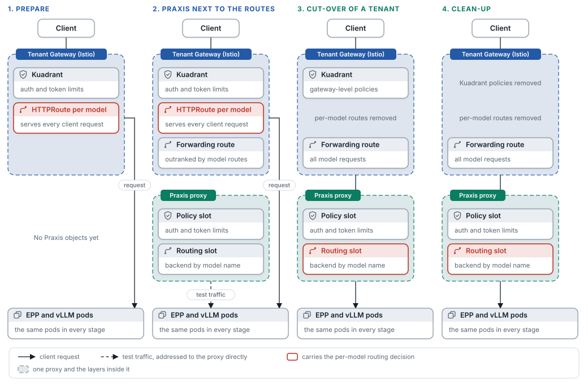

# Migration

Praxis data plane, MaaS and KServe.

> [!WARNING]
> The migration scenario is a work in progress and shouldn't be taken seriously yet.

A tenant can move from Gateway API on Istio to Praxis in stages, with the tenant Gateway kept as the ingress and no change to what users write. The preparation in MaaS and KServe can start now. The cut-over depends on work in Praxis that is still open.

| Topic | Summary | Detail |
|---|---|---|
| Can start now | Preparation in MaaS and KServe | MaaS stops depending on the HTTPRoute, and KServe publishes complete status for a service without a route. Neither change needs Praxis, and neither changes client traffic. |
| Waits on Praxis | Proxy deployment, the EPP client and the policy engine | `gateway-controller` does not deploy a proxy yet, the EPP client does not cover services with a scheduler, and the policy engine has no Kubernetes token authentication. |
| Unit of the switch | A tenant, not a model | With the Gateway kept in front, the requests for a model follow its HTTPRoute until the route is removed, and routes are removed per Gateway. |

## Stages

We looked for a sequence in which clients keep the hostname, the request URL and the model ID they use today. That requires the tenant Gateway to stay in front of the Praxis proxy, with one route that forwards model requests to it. On that Gateway the per-model HTTPRoute and the forwarding route do not share traffic. The per-model rules are more specific, so the requests for a model reach Praxis only after its HTTPRoute is removed. The four stages follow from that.

<picture><source media="(prefers-color-scheme: dark)" srcset="figs/migration-stages-dark.svg"></picture>

The path of a client request in each stage. In stages 1 and 2 the per-model HTTPRoute serves every request. From stage 3 the forwarding route sends model requests to the Praxis proxy of the tenant. The EPP and the pods are the same in all four.

### Who does what, and why

- The user changes nothing. The `LLMInferenceService` keeps `spec.router.route` and `gateway.refs`, and the `MaaSModelRef` stays as it is.
- KServe publishes the backend, the port, the served model names and `Ready` in status with or without a route in stage 1. In stage 3 it stops rendering the HTTPRoute for a Gateway that is in front of a Praxis proxy.
- MaaS reads the service status in place of the route in stage 1. In stage 2 it creates the `Proxy` of the tenant with a routing entry per `MaaSModelRef`, the `Policy`, and the forwarding route on the tenant Gateway. The forwarding route has no owner today, and MaaS already manages the other objects of the tenant.
- `gateway-controller` renders and deploys the proxy from the objects MaaS creates.
- The platform admin marks the tenant Gateway to start stage 3, and removes the mark to roll it back.

| Stage | Who | What changes | Client traffic | Rollback |
|---|---|---|---|---|
| 1 | MaaS, KServe | MaaS takes the backend, the model ID, readiness and the tenant from the `LLMInferenceService` status and its `gateway.refs`, and no longer looks up the HTTPRoute. KServe publishes complete status for a service without a route. | Istio | None needed. Behaviour is unchanged. |
| 2 | MaaS, `gateway-controller` | The tenant gets a `Proxy` and a `Policy`, and each `MaaSModelRef` gets a routing entry in the `Proxy` that points at the same pool or Service as the route. MaaS adds the forwarding route to the tenant Gateway. The proxy is tested with requests addressed to it directly. | Istio | Delete the Praxis objects and the forwarding route. |
| 3 | Platform admin, KServe | The tenant Gateway is marked. KServe deletes the HTTPRoutes of the services on that Gateway, and their spec and status stay as they are. Their requests now match the forwarding route. | Praxis | Remove the mark. KServe creates the routes again, and they take precedence. |
| 4 | MaaS | MaaS stops generating Kuadrant policies for the tenant and deletes the ones on the Gateway. | Praxis | Generate the Kuadrant policies again, then roll back stage 3. |

## What can start now

Stage 1 is the largest part of the work on our side, and it does not depend on Praxis. It replaces the HTTPRoute as the integration point between MaaS and KServe with the service status, and it changes nothing for clients. The individual changes are listed in [Decision](decision.md).

- MaaS reads the backend, the model ID and readiness from the service status, resolves the tenant from `gateway.refs`, and writes the `InferenceObjective` without checking the route.
- KServe lets a service with a scheduler and no route become `Ready`, and publishes the pool, the port, the served model names and the request paths that go through the EPP for it.
- KServe skips the HTTPRoute for a Gateway that is in front of a Praxis proxy. Which property of the Gateway shows that is to be confirmed. Reading a property of the parent Gateway has a precedent in [`serving.kserve.io/model-based-routing-only`](https://github.com/kserve/kserve/blob/cdbe9860583e36f29d46a58179d86299e8faa41d/pkg/controller/v1alpha2/llmisvc/router.go#L83), which is read from the parent Gateway as well.
- Stage 1 has to be complete before stage 3. On today's MaaS code, removing the route sets the `MaaSModelRef` to `Pending`, deletes the per-model rate limit policy, and leaves MaaS unable to find the tenant of the model.

## What the cut-over waits for

Stages 2 and 3 cannot be carried out today. They need the items below from Praxis, and none of them is in our control. The dates are the milestone dates as read on 2026-11-20.

| Needed for | What is missing | State | Tracked in |
|---|---|---|---|
| Stage 2 | A proxy that is rendered and deployed from a `Proxy`. | In an open pull request. | [`gateway-controller#14`](https://github.com/praxis-proxy/gateway-controller/issues/14) to [`gateway-controller#17`](https://github.com/praxis-proxy/gateway-controller/issues/17), and the pull request [`gateway-controller#82`](https://github.com/praxis-proxy/gateway-controller/pull/82). |
| Stage 3, services with a scheduler | An EPP client that selects its target per model and sends response bodies to the EPP. | It takes one static target and is off in published builds. How its connection to the EPP is secured is an open question in [Decision](decision.md). | [`ai#2111`](https://github.com/praxis-proxy/ai/issues/2111), [`ai#2112`](https://github.com/praxis-proxy/ai/issues/2112) and [`praxis#1588`](https://github.com/praxis-proxy/praxis/issues/1588), opened on 2026-11-23 with no milestone. The target per model has no issue. |
| Stage 3 | Kubernetes token authentication and authorization. | Not implemented. | [`policy#213`](https://github.com/praxis-proxy/policy/issues/213) in [`0.8.0`](https://github.com/praxis-proxy/policy/milestone/8), due 2026-12-18. [`policy#214`](https://github.com/praxis-proxy/policy/issues/214) in [`0.7.0`](https://github.com/praxis-proxy/policy/milestone/7), due 2026-12-03. |
| Stage 3 | A token limit per model. | Route matching in the policy engine does not support headers. | [`policy#352`](https://github.com/praxis-proxy/policy/issues/352) in [`0.8.0`](https://github.com/praxis-proxy/policy/milestone/8). [`policy#308`](https://github.com/praxis-proxy/policy/issues/308) in [`1.0.0`](https://github.com/praxis-proxy/policy/milestone/4), due 2027-01-08. |
| Stage 3, more than one proxy replica | Limit counters shared between replicas. | Counters are kept per replica. | [`policy#127`](https://github.com/praxis-proxy/policy/issues/127) in [`0.7.0`](https://github.com/praxis-proxy/policy/milestone/7). |

- The `ModelProvider` API is not needed for any stage, because MaaS writes the routing into the `Proxy`.
- Because the cut-over is per tenant, one service with a scheduler blocks the cut-over of its tenant until the EPP client is extended.
- On the ODH build, strict NetworkPolicy takes the allowed namespaces from Gateway references only. The namespace of the proxy has to be allowed before stage 2.
- The FIPS image of Praxis is built without the policy filter today, and stage 3 needs it.

## Limits of running Praxis next to the routes

Stage 2 is a verification stage. It shows that the proxy, the policies and the routing of a tenant work, and it does not move client traffic to Praxis.

- KServe's model rules match [an exact path and the model header](https://github.com/kserve/kserve/blob/cdbe9860583e36f29d46a58179d86299e8faa41d/config/llmisvcconfig/config-llm-router-route.yaml#L193-L200), which is more specific than a forwarding route can be, and Gateway API [gives precedence to the more specific rule](https://github.com/kubernetes-sigs/gateway-api/blob/v1.6.2/apis/v1/httproute_types.go#L184-L200). The forwarding route therefore receives the requests for a model only after its per-model route has been removed.
- The mark is on the Gateway, so the cut-over moves all services of a tenant together. Moving a single model would need a switch per service, which is a new field or annotation in what users write. We left it out to keep the user-facing API unchanged.
- In the open pull request for the proxy deployment ([`gateway-controller#82`](https://github.com/praxis-proxy/gateway-controller/pull/82)), Praxis reloads a routing change and the proxy pods are not replaced. The status of the `Proxy` does not report when the pods have loaded it, so after a model is published in stage 2 or later MaaS cannot tell when it is served.
- Limitador and Praxis do not share counters. AFAICT the token counters of a subscription restart at the cut-over.
- The gateway-level `AuthPolicy` and the default-deny rate limit apply to the forwarding route too. Either MaaS attaches policies to the forwarding route that allow the requests, which authenticates a request twice, or the gateway-level policies are removed in stage 3 and not in stage 4. This decision is open.
- In stage 2 Istio and Praxis call the same EPP. Its TLS is controlled by a cluster-wide KServe setting, and AFAICT the Praxis `ext_proc` client has no TLS, so test traffic for a service with a scheduler does not work yet either.
- Stopping or deleting a service removes its pool and its Service immediately. From stage 2 MaaS has to remove the routing entry at the same time.
- The model ID is a contract. Clients send the name MaaS publishes today, so the routing key has to equal `status.resolvedModelAlias`.
- Requests to per-model path URLs of the form `/<namespace>/<name>/v1/...` stop working in stage 3 unless Praxis serves paths. What else clients and admins can observe is listed in [Decision](decision.md).

## Not verified

The stages are a design based on reading code and issues. The following was not verified.

- Nothing was run on a cluster.
- That the per-model rules take precedence over a forwarding route is read from the Gateway API types and KServe's route preset. It was not tested on Istio.
- The forwarding route, its owner and the mark on the Gateway do not exist. They are suggestions.
- The milestone dates are plans.
- How many services use a scheduler, which decides how many tenants wait for the EPP client.
- Whether rate limit counters can be carried over at the cut-over.
